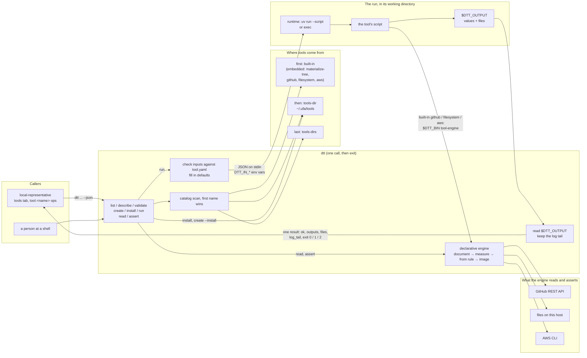

# dtt — the declarative tool tool

`dtt` creates, checks and runs **T3s** (declarative-tool-tool-tools). A T3 is
a tool described by a small YAML schema and written in any language, with
Python (run through [`uv`](https://docs.astral.sh/uv/)) as the default.

`dtt` is a **transient CLI**. Each call starts, does one thing and exits.
There is no server, no representable connection and no restart signal.
Its main caller is local-representative, which uses it for its **tools** tab
and the `tool.<name>` control ops (see
[`local-representative/README.md`](../local-representative/README.md#tools-tab)).
With `--json`, one JSON document on stdout is the contract.

It modernizes the stub at `ignored-scratch/AI-sandboxing/declarative-tool-tool`
(`tool-tool create/register/execute`). The registry file is gone: the tools
on disk are the only record of what's installed.

For a hands-on walkthrough, run the [brief tour](docs/brief-tour.md) as a
ridealong (`ridealong dtt/docs/brief-tour.md` from federation-command).

## How it fits together



## Commands

```
dtt list                       [--json]
dtt describe <tool>            [--json]
dtt validate <dir|tool.yaml|-> [--schema-only] [--json]
dtt create <name>              [--dir <parent> | --install] [--runtime uv|exec] [--json]
dtt install <dir>              [--force] [--json]     (alias: register)
dtt run <tool>                 [--arg name=value]... [--input <file|->]
                               [--workdir <dir>] [--timeout <d>] [--json]
dtt read <document|->          [--image <file|->] [--force]
dtt assert <document|->        [--image <file|->] [--force]
dtt --version
```

`<tool>` may be written as its control op, `tool.<name>`. `--config <dir>`
works as it does for every UFA app.

**Exit status** is fixed:

| Code | Meaning |
|---|---|
| 0 | success |
| 1 | the tool failed: it exited non-zero, timed out, wrote bad output, or its runtime (`uv`) is missing |
| 2 | bad input: usage, an unknown tool, inputs that don't fit the schema, or an invalid `tool.yaml` |

## Where tools come from

There's no index. Every call scans these places, in this order:

1. **built-in**: tools embedded in the binary (`builtin/`), currently
   `materialize-tree` and the declarative tools `github`, `filesystem` and
   `aws` (see [Declarative tools](#declarative-tools-read-and-assert)).
2. **user**: the `tools-dir` setting, `~/.ufa/tools` by default. `install`
   and `create --install` put tools here.
3. **tools-dirs**: each directory in the `tools-dirs` setting (a comma- or
   space-separated list).

Each tool is a directory **named after the tool** that holds `tool.yaml` and
its script. If two tools share a name, the first one found wins. The others
are listed as `shadowed` in `dtt list --json`. Directories that look like
tools but don't validate are listed as `problems`.

`install <dir>` validates the tool and copies it into the tools directory,
leaving out hidden files such as a `.venv`. It replaces an installed copy only
with `--force`, and it refuses a built-in tool's name.

Settings go in `~/.ufa/config/dtt.yaml` (or `global.yaml`):

```yaml
tools-dir: ~/.ufa/tools
tools-dirs: /srv/shared-tools, ~/work/tools
uv: /usr/local/bin/uv     # the uv binary, if it isn't on PATH
```

## The schema: `format: dtt-v1`

```yaml
format: dtt-v1                 # required; versioned like lr-control-v1
name: materialize-tree         # lowercase letters, digits, '-'; matches its directory
description: Build a directory tree from a flat YAML description ...
describe: materialize a directory tree from YAML   # optional: how a control step lists a call ({input} is replaced)
inputs:
  - name: spec                 # lowercase letters, digits, '_'
    type: text                 # string (default), text, int, number, bool, path
    help: flat YAML mapping each relative path to its content
    required: true             # a required input takes no default
  - name: overwrite
    type: bool
    default: "false"
  - name: mode
    choices: [fast, slow]      # optional: the only values allowed
    default: fast
outputs:
  values:                      # named values; a control run saves each one under its name
    - name: root
      help: the tree's absolute path
  files:                       # named files; a control run copies each one into the files tab
    - name: archive
      help: the tree as tree.zip
entrypoint:
  runtime: uv                  # uv (default) or exec
  script: main.py              # relative to the tool's directory
  timeout: 120s                # default 60s, at most 1h
```

Inputs carry the same fields as a control op's arguments
(`ControlOpArg`: `name`, `help`, `required`, `default`), plus `type` and
`choices`. That makes a T3 a control op with no translation layer: each
entry in `dtt list --json` starts with `op` (`tool.<name>`), `summary`,
`describe` and `args`, which is the `ControlOpSpec` shape.

Unknown keys are errors, so typos show up rather than being ignored. The
names `op`, `save_prefix` and `hint` are reserved for the arguments
local-representative adds to every `tool.<name>` op. Input names and output
names share one namespace.

## Runtimes

- **`uv`** (the default) runs `uv run --quiet --script <script>`. Declare the
  script's dependencies inline with a [PEP 723](https://peps.python.org/pep-0723/)
  block, and uv installs them on first use:

  ```python
  #!/usr/bin/env -S uv run --script
  # /// script
  # requires-python = ">=3.10"
  # dependencies = ["pyyaml>=6"]
  # ///
  ```

  If `uv` isn't installed, `dtt run` fails with exit 1 and a message saying
  so. `uv` isn't part of `make check-dev-deps`. Install it on any host that
  runs uv tools.
- **`exec`** runs the script directly, so it must be executable and start
  with a `#!` line.

## The run contract

`dtt run` checks the inputs against the schema. Unknown names, missing
required values, wrong types and values outside `choices` exit with code 2
before anything runs. Defaults are filled in. Then dtt:

- **creates the working directory**, or uses `--workdir`. The tool runs with
  this as its current directory. Without `--workdir`, dtt creates a new
  directory under `$TMPDIR` and leaves it in place afterwards. A built-in
  tool is unpacked into `.dtt-tool/` inside it.
- **passes the inputs** two ways:
  - as **JSON on stdin**, typed: an `int` is a number, a `bool` is
    `true`/`false`, a `path` has `~` expanded, and an unset optional input
    with no default is `null`;
  - as **`DTT_IN_<NAME>`** environment variables, which are strings, with
    unset inputs left out. Alongside them are `DTT_TOOL`, `DTT_TOOL_DIR`,
    `DTT_WORKDIR`, `DTT_OUTPUT`, `DTT_BIN` (dtt's own path, so a tool can
    call it back) and `DTT_CALLER_DIR` (where dtt was run from, for relative
    paths a caller passed).
- **reads the tool's results** from the file named by `$DTT_OUTPUT`:

  ```json
  {"values": {"root": "/tmp/x/tree", "file_count": 2}, "files": {"archive": "tree.zip"}}
  ```

  A file's path is relative to the working directory, or absolute. Values
  that aren't strings are kept as JSON text (`2` becomes `"2"`). An output
  that isn't declared in `tool.yaml` makes the run fail. A declared output
  can be left out.
- **keeps the log**: stderr is the log, and stdout is folded into it too.
  The result carries the last 40 lines.
- **enforces the timeout** by killing the tool's whole process group,
  including uv's Python child.

The run ends with one result:

```json
{
  "ok": true,
  "tool": "materialize-tree",
  "outputs": {"root": "/tmp/dtt-run-…/tree", "file_count": "2", "dir_count": "1"},
  "files": [{"name": "archive", "path": "/tmp/dtt-run-…/tree.zip", "size": 312}],
  "log_tail": "file  README.md (7 bytes)\n…",
  "exit_code": 0,
  "workdir": "/tmp/dtt-run-…",
  "duration_ms": 412
}
```

On failure, `ok` is false and `error` says why. `timed_out` is set when the
tool ran out of time.

## The reference T3: `materialize-tree`

This is the worked example the original README planned. Its `spec` input is
a flat YAML mapping. Each key is a relative path and its value is that
file's content. A key ending in `/` is a directory. The tool builds the tree
under `root`, which defaults to `tree/` in the working directory. It refuses
to replace existing files unless `overwrite` is true, and it packs the
entries into `tree.zip`.

```sh
cat > spec.yaml <<'EOF'
spec: |
  README.md: "# hello"
  src/: ~
  src/main.py: print('hi')
EOF
dtt run materialize-tree --input spec.yaml
```

## Declarative tools: read and assert

Besides running T3s, dtt **reads** and **asserts** DTT documents. A
document names DTT objects (a GitHub repository's pull requests, files under
a directory, ECS tasks) and the state they should have:

- **Reading** measures every object the document names and returns an
  **image**: a JSON document of their measured state, plus what an assert
  would do to each asserted field. Nothing changes.
- **Asserting** makes the document true where it may, and always returns
  the image as it left things.

```sh
dtt read   <document|->                       # the image on stdout
dtt assert <document|-> [--image <file|->] [--force]
```

The three **built-in declarative tools** run the same engine through the
tools interface. Each reads one provider's statements (plus `timestamp`):

| Tool | Objects | Example |
|---|---|---|
| `github` | a repository, its open pull requests | [`examples/github-prs.dtt.yaml`](examples/github-prs.dtt.yaml) |
| `filesystem` | JSON and text files under a directory | [`examples/filesystem-json.dtt.yaml`](examples/filesystem-json.dtt.yaml) |
| `aws` | ECS tasks, selected by tag, and their tags | [`examples/aws-ecs-tags.dtt.yaml`](examples/aws-ecs-tags.dtt.yaml) |

```sh
dtt run filesystem --arg document_file=examples/filesystem-json.dtt.yaml --arg mode=assert
```

Their inputs are `document` (the text) or `document_file` (a path, relative
to where dtt runs), `mode` (`read`, the default, or `assert`), `from_image`
(an earlier image's JSON or its file's path) and `force`. Their outputs are
the counts `changed`, `held`, `unchanged`, `would_change` and `objects`,
plus the `image` file. In local-representative they are the `tool.github`,
`tool.filesystem` and `tool.aws` control ops. They are `exec` tools whose
script runs `"$DTT_BIN" tool-engine <provider>`, and `dtt run` sets
`DTT_BIN` to its own path. So they need no `uv`, and they keep the run
contract above: the timeout, the log, and `$DTT_OUTPUT`.

More examples, proposed for discussion and not implemented yet, are in
[`docs/additional-proposed-examples.md`](docs/additional-proposed-examples.md).

### Documents

A document is a list of **statements**. Each is a top-level key naming an
object, with any of these under it:

```yaml
github.orgs.je-sidestuff.repos.AI-sandboxing:   # a DTT path: provider first
  read: *              # measure its extra fields too (here, its open PRs); or a list of them
  alias: the-repo      # a name later statements and ${{...}} references use
timestamp:
  select: "now"        # which object(s) under the path
the-repo:              # an alias: the same object again
  assert:              # the state it should have
    prs:
      select: {from: condoc/blah1/main, to: main, title: Merge one branch}
      state:
        exists: true
        body: |
          Updated ${{timestamp.human-readable}}
```

- The same key may start several statements. The example asserts two PRs
  through `the-repo`, one statement each.
- `${{name.field}}` is a field of an object measured earlier in the
  document, named by its path or alias: `${{timestamp.unix}}` or
  `${{the-repo.default_branch}}`.
- A tab in a line's indent counts as four columns.
- As in `tool.yaml`, every scalar is a string, unknown keys are errors, and
  the whole document is checked before anything is measured. A mistake on
  the last line changes nothing.

### The from rule

An assert changes a field only when what the field holds now is one of its
**from** values. Anything else is **held**: left alone, and reported in the
image as `held`. The from values are:

1. **empty**, always: missing, blank, `false`, `{}`. An assert creates what
   doesn't exist yet and fills in what's blank.
2. any value under **`from.<field>`** beside the field. That can be one
   value, a list, or a mapping whose keys are only labels:

   ```yaml
   body: ...
   from.body:
     empty: ''
     notimeyet: |
       This PR will reintegrate a branch.
   ```

3. with **`--image`** (`from_image`), the value that image saw. This is
   optimistic concurrency: read, look at the image, then assert with it. A
   field someone else changed in between is held.
4. with **`--force`**, anything. It is the same as `from.<field>: "*"` on
   every field.

The rule covers `exists` too. Removing a file or closing a PR changes
`exists` from `true`, which isn't empty, so it needs a from value, the
image or `--force`. Values are compared with line endings and trailing
whitespace evened out. A JSON file's content is compared as JSON, so
spacing and key order don't count.

### The image

```json
{
  "ok": true, "format": "dtt-image-v1", "mode": "assert", "taken": "2026-10-24T15:04:05Z",
  "objects": [
    {"id": "filesystem.items[/tmp]", "path": "filesystem.items", "alias": "temp-folder", "line": 1,
     "state": {"abspath": "/tmp", "exists": true, "kind": "dir"}},
    {"id": "filesystem.items[/tmp/my-json.json]", "path": "filesystem.items", "line": 10,
     "state": {"abspath": "/tmp/my-json.json", "exists": true, "type": "json", "content": {"name": "My Json File.", "...": "..."}}}
  ],
  "fields": [
    {"object": "filesystem.items[/tmp/my-json.json]", "field": "content", "outcome": "held",
     "why": "it holds something else (not empty, not a from value) -- ...", "was": {"name": "theirs"}, "want": {"...": "..."}, "line": 13}
  ],
  "summary": {"held": 1}
}
```

Each object's `id` is what a later `--image` is matched by. A field's
`outcome` is `unchanged`, `changed`, `held` or, when reading,
`would-change`. Held fields don't fail the run. A document that doesn't
check exits 2. A provider that fails part way (an API error, say) exits 1,
and the image so far carries `error`.

### Providers

| Path | select | assert | Fields |
|---|---|---|---|
| `timestamp` | `now` (default) or an RFC 3339 time | (read only) | `unix`, `iso`, `human-readable`, `date` |
| `filesystem.items` | `abspath:` a directory or file | `items:` a map of relative path to `{type: json\|text, content, exists}` | an item's `exists`, `content`. `read: *` lists a directory's items |
| `github.orgs.<owner>.repos.<repo>` (or `users`) | (the path) | `prs:` one or a list of `{select: {from, to, title}, state: {exists, title, body}}` | a PR's `exists`, `title`, `body`. `read: *` lists open PRs |
| `aws.accounts.<current\|id>[.regions.<r>].ecs.tasks` | `tags:` (`*` for any value), `cluster:` | `tags:` key: value | `tags.<key>`, per matched task |

- **github** matches a PR by `from` and `to` (the default branch if
  omitted) among the open ones. `select.title` is only the name a new PR
  gets, and `exists: false` closes the PR. The token comes from
  `$GITHUB_TOKEN`, then `$GH_TOKEN`, then `gh auth token`.
  `$DTT_GITHUB_API` points the provider at another API host.
- **filesystem** writes through a temporary file and rename, making
  directories if it needs to. A JSON item keeps the document's key order.
- **aws** runs the AWS CLI (`$DTT_AWS_CLI`, default `aws`), so credentials
  and region come from wherever the CLI finds them. An account id in the
  path is checked against `sts get-caller-identity`.

## Writing a tool

```sh
dtt create my-tool --install     # ~/.ufa/tools/my-tool: tool.yaml + main.py, ready to run
$EDITOR ~/.ufa/tools/my-tool/tool.yaml ~/.ufa/tools/my-tool/main.py
dtt validate ~/.ufa/tools/my-tool
dtt run my-tool --arg message=hello
```

Without `--install`, `create` scaffolds the tool in the current directory.
Use `dtt install <dir>` once it validates.

## Build and test

```sh
make build    # ./dtt, built-ins embedded
make test     # the materialize-tree run test is skipped without uv (and needs the network once, for pyyaml)
```

The declarative tests run offline. GitHub is a fake REST server and AWS a
fake CLI, and the `filesystem` tool runs end to end through `dtt run`.

`make deploy-dev-binaries` at the repo root puts `dtt` in `/AI-evo1-dev/bin`,
where local-representative finds it.
