# dtt — the declarative tool tool

`dtt` creates, checks and runs **T3s** (declarative-tool-tool-tools). A T3 is
a tool described by a small YAML schema and written in **Python** (run
through [`uv`](https://docs.astral.sh/uv/) when it's installed) or **Go**
(built by dtt before it runs). Those are the only two languages for now; see
[Runtimes](#runtimes).

`dtt` is a **transient CLI**. Each call starts, does one thing and exits.
There is no server, no representable connection and no restart signal.
Its main caller is local-representative, which uses it for its **tools** tab
and the `tool.<name>` control ops (see
[`local-representative/README.md`](../local-representative/README.md#tools-tab)).
With `--json`, one JSON document on stdout is the contract.

It modernizes the stub at `ignored-scratch/AI-sandboxing/declarative-tool-tool`
(`tool-tool create/register/execute`). The registry file is gone: the tools
on disk are the only record of what's installed.

For a hands-on walkthrough, run the [brief tour](docs/brief-tour.md) as a
ridealong (`ridealong dtt/docs/brief-tour.md` from federation-command).

The words this README uses — tool, tool call (definition, specification,
execution), composition, read, image, select, assert, from, in-place and
pathless calls — are defined in [`docs/terms.md`](docs/terms.md).

## How it fits together

```mermaid
flowchart LR
    subgraph callers["Callers"]
        lr["local-representative<br/>tools tab, tool.&lt;name&gt; ops"]
        cli["a person at a shell"]
    end

    subgraph dtt["dtt (one call, then exit)"]
        cmd["list / describe / validate<br/>create / install / run<br/>read / assert / delete"]
        scan["catalog scan, first name wins"]
        check["check inputs against tool.yaml<br/>fill in defaults"]
        collect["read $DTT_OUTPUT<br/>keep the log tail"]
        engine["declarative engine<br/>document → measure → from rule → image"]
    end

    subgraph targets["What the engine reads and asserts"]
        gh["GitHub REST API"]
        files["files on this host"]
        localgit["local git repos on this host<br/>(no remote)"]
        awsapi["AWS, via boto3<br/>(python3 or uv)"]
        lrapi["local-representative's HTTP API<br/>control sequences + runs (any node),<br/>Polly clips, composer compositions"]
    end

    composer["composer (:8089)<br/>save + render a composition<br/>→ local-representative's files"]

    subgraph sources["Where tools come from"]
        builtin["first: built-in<br/>(embedded: materialize-tree,<br/>github, git, filesystem, aws, localrep, declare, composer)"]
        user["then: tools-dir<br/>~/.ufa/tools"]
        extra["last: tools-dirs"]
    end

    subgraph runarea["The run, in its working directory"]
        runtime["runtime python: uv run --script (or python3)<br/>runtime go: go build, then the binary"]
        script["the tool's script"]
        outfile["$DTT_OUTPUT<br/>values + files"]
    end

    lr -- "dtt ... --json" --> cmd
    cli --> cmd
    cmd --> scan
    scan --> builtin
    scan --> user
    scan --> extra
    cmd -- "run" --> check
    check -- "JSON on stdin<br/>DTT_IN_* env vars" --> runtime
    runtime --> script
    script --> outfile
    outfile --> collect
    collect -- "one result: ok, outputs, files,<br/>log_tail, exit 0 / 1 / 2" --> lr
    cmd -- "install, create --install" --> user
    cmd -- "read, assert, delete" --> engine
    script -- "built-in github / filesystem / aws / localrep:<br/>$DTT_BIN tool-engine" --> engine
    engine --> gh
    engine --> files
    engine --> localgit
    engine --> awsapi
    engine --> lrapi
    script -- "built-in composer (go):<br/>HTTP API" --> composer
```



## Commands

```
dtt list                       [--json]
dtt describe <tool>            [--json]
dtt validate <dir|tool.yaml|-> [--schema-only] [--json]
dtt create <name>              [--dir <parent> | --install] [--runtime python|go] [--json]
dtt install <dir>              [--force] [--json]     (alias: register)
dtt run <tool>                 [--arg name=value]... [--input <file|->]
                               [--workdir <dir>] [--timeout <d>] [--json]
dtt read <document|dir|->      [--var name=value]... [--image <file|->] [--force]
dtt assert <document|dir|->    [--var name=value]... [--image <file|->] [--force]
dtt delete <document|dir|->    [--var name=value]... [--image <file|->] [--force]
dtt calls [<document|dir>]     [--json]
dtt examples [<name>]          [--json]
dtt examples --specifications  [--json]
dtt --version
```

`<tool>` may be written as its control op, `tool.<name>`. `--config <dir>`
works as it does for every UFA app. A `<dir>` holding `.dtttc` is an
in-place call; any other document is pathless, staged under
`~/.ufa/dtt/pathless/` (see [In-place and pathless calls](docs/terms.md#in-place-and-pathless-calls)).
Either way the image is printed and also kept as a timestamped file in the
call's `images/`, and the call's directory goes to the top of the recent
calls, `~/.ufa/dtt/recent-calls.json`. `dtt calls` lists them, newest
first; `dtt calls <dir|document>` describes one (listed or not): its
document and the images kept for it. A pathless call's staging directory
may be given back to read, assert or delete to call it again. An in-place
call's `.dtttc` may also `include:` some of dtt's example compositions,
which its document may then call though they aren't in its directory (see
[Example specifications](#example-specifications)).

**Recording.** `run`, `read`, `assert` and `delete` are recorded through
clauditable by default: dtt runs itself again under it, so the call lands in
the session it was made from and is also copied to
`<agent-records>/dtt-calls/<unix time>-<rrr>.txt`, which names that session.
With no clauditable on `PATH` (or beside dtt, or at the `clauditable`
setting), or one that won't start, the call runs unrecorded; `record: off`
or `DTT_RECORD=off` turns recording off. local-representative's tools tab
lists the copies under **history**. See [Recording](docs/terms.md#recording).

**Exit status** is fixed:

| Code | Meaning |
|---|---|
| 0 | success |
| 1 | the tool failed: it exited non-zero, timed out, wrote bad output, didn't build (go), or its runtime (uv/python, or the go toolchain) is missing |
| 2 | bad input: usage, an unknown tool, inputs that don't fit the schema, or an invalid `tool.yaml` |

## Where tools come from

There's no index. Every call scans these places, in this order:

1. **built-in**: tools embedded in the binary (`builtin/`), currently
   `materialize-tree` (python), the declarative tools `github`, `git`,
   `filesystem`, `aws`, `localrep` and `declare` (see [Declarative tools](#declarative-tools-read-assert-and-delete)),
   and `composer` (go; see [The composer tool](#the-composer-tool)).
2. **user**: the `tools-dir` setting, `~/.ufa/tools` by default. `install`
   and `create --install` put tools here.
3. **tools-dirs**: each directory in the `tools-dirs` setting (a comma- or
   space-separated list).

Each tool is a directory **named after the tool** that holds `tool.yaml` and
its script. If two tools share a name, the first one found wins. The others
are listed as `shadowed` in `dtt list --json`. Directories that look like
tools but don't validate are listed as `problems`.

`install <dir>` validates the tool and copies it into the tools directory,
leaving out hidden files such as a `.venv`. It replaces an installed copy only
with `--force`, and it refuses a built-in tool's name.

Settings go in `~/.ufa/config/dtt.yaml` (or `global.yaml`):

```yaml
tools-dir: ~/.ufa/tools
tools-dirs: /srv/shared-tools, ~/work/tools
uv: /usr/local/bin/uv     # the uv binary, if it isn't on PATH
python: python3           # what python tools run with when uv isn't installed
go: /usr/local/go/bin/go  # the go toolchain go tools are built with
pathless-dir: ~/.ufa/dtt/pathless             # where pathless calls are staged
recent-calls: ~/.ufa/dtt/recent-calls.json    # the recent calls dtt calls lists
examples-dir: ~/.ufa/dtt/examples             # where dtt examples --specifications unpacks them
```

## The schema: `format: dtt-v1`

```yaml
format: dtt-v1                 # required; versioned like lr-control-v1
name: materialize-tree         # lowercase letters, digits, '-'; matches its directory
description: Build a directory tree from a flat YAML description ...
describe: materialize a directory tree from YAML   # optional: how a control step lists a call ({input} is replaced)
inputs:
  - name: spec                 # lowercase letters, digits, '_'
    type: text                 # string (default), text, int, number, bool, path
    help: flat YAML mapping each relative path to its content
    required: true             # a required input takes no default
  - name: overwrite
    type: bool
    default: "false"
  - name: mode
    choices: [fast, slow]      # optional: the only values allowed
    default: fast
outputs:
  values:                      # named values; a control run saves each one under its name
    - name: root
      help: the tree's absolute path
  files:                       # named files; a control run copies each one into the files tab
    - name: archive
      help: the tree as tree.zip
entrypoint:
  runtime: python              # python (default) or go
  script: main.py              # relative to the tool's directory; a .py file, or a go tool's main .go file
  timeout: 120s                # default 60s, at most 1h
```

Inputs carry the same fields as a control op's arguments
(`ControlOpArg`: `name`, `help`, `required`, `default`), plus `type` and
`choices`. That makes a T3 a control op with no translation layer: each
entry in `dtt list --json` starts with `op` (`tool.<name>`), `summary`,
`describe` and `args`, which is the `ControlOpSpec` shape.

Unknown keys are errors, so typos show up rather than being ignored. The
names `op`, `save_prefix` and `hint` are reserved for the arguments
local-representative adds to every `tool.<name>` op. Input names and output
names share one namespace.

## Runtimes

A tool is written in Python or Go, named by `entrypoint.runtime`:

- **`python`** (the default) runs `uv run --quiet --script <script>` when uv
  is installed. Declare the script's dependencies inline with a
  [PEP 723](https://peps.python.org/pep-0723/) block, and uv installs them on
  first use:

  ```python
  #!/usr/bin/env -S uv run --script
  # /// script
  # requires-python = ">=3.10"
  # dependencies = ["pyyaml>=6"]
  # ///
  ```

  Without uv it runs `python3 <script>`, and the dependencies must already
  be installed. With neither, `dtt run` fails with exit 1 and a message
  saying so. `script` must be a `.py` file. `runtime: uv`, the older name,
  is still read as `python`.
- **`go`**: `script` is the `.go` file holding `func main`. dtt builds the
  package in that file's directory with `go build` into the run's working
  directory (`.dtt-go-bin/<name>`), then runs the binary. It builds in the
  module of the nearest `go.mod` between that directory and the tool's own,
  so `script: cmd/x/main.go` works with a `go.mod` at the tool's root. A
  package with no `go.mod` uses only the standard library: dtt builds it from a copy (in
  `.dtt-go-src/`) with a `go.mod` it writes, so the tool's directory isn't
  written to. Add a `go.mod` and `go.sum` to use other modules. The build runs
  with `GOWORK=off` and for at most 5 minutes, outside the tool's own timeout,
  and its output heads the run's log. Go's build cache makes later runs
  quick. Without the go toolchain, or when the build fails, `dtt run` fails
  with exit 1.

`dtt create --runtime python|go` scaffolds either. The built-in
`github`, `filesystem` and `aws` tools use a third runtime, `exec`, which runs
a script directly: theirs is one line of shell handing over to dtt itself.
It's still accepted for tools made with it before, but `create` no longer
offers it.

## The run contract

`dtt run` checks the inputs against the schema. Unknown names, missing
required values, wrong types and values outside `choices` exit with code 2
before anything runs. Defaults are filled in. Then dtt:

- **creates the working directory**, or uses `--workdir`. The tool runs with
  this as its current directory. Without `--workdir`, dtt creates a new
  directory under `$TMPDIR` and leaves it in place afterwards. A built-in
  tool is unpacked into `.dtt-tool/` inside it.
- **passes the inputs** two ways:
  - as **JSON on stdin**, typed: an `int` is a number, a `bool` is
    `true`/`false`, a `path` has `~` expanded, and an unset optional input
    with no default is `null`;
  - as **`DTT_IN_<NAME>`** environment variables, which are strings, with
    unset inputs left out. Alongside them are `DTT_TOOL`, `DTT_TOOL_DIR`,
    `DTT_WORKDIR`, `DTT_OUTPUT`, `DTT_BIN` (dtt's own path, so a tool can
    call it back) and `DTT_CALLER_DIR` (where dtt was run from, for relative
    paths a caller passed).
- **reads the tool's results** from the file named by `$DTT_OUTPUT`:

  ```json
  {"values": {"root": "/tmp/x/tree", "file_count": 2}, "files": {"archive": "tree.zip"}}
  ```

  A file's path is relative to the working directory, or absolute. Values
  that aren't strings are kept as JSON text (`2` becomes `"2"`). An output
  that isn't declared in `tool.yaml` makes the run fail. A declared output
  can be left out. A tool that exits non-zero still has the outputs it
  wrote reported beside the error (if they read cleanly).
- **keeps the log**: stderr is the log, and stdout is folded into it too.
  The result carries the last 40 lines.
- **enforces the timeout** by killing the tool's whole process group,
  including uv's Python child. A go tool's build isn't counted.

The run ends with one result:

```json
{
  "ok": true,
  "tool": "materialize-tree",
  "outputs": {"root": "/tmp/dtt-run-…/tree", "file_count": "2", "dir_count": "1"},
  "files": [{"name": "archive", "path": "/tmp/dtt-run-…/tree.zip", "size": 312}],
  "log_tail": "file  README.md (7 bytes)\n…",
  "exit_code": 0,
  "workdir": "/tmp/dtt-run-…",
  "duration_ms": 412,
  "events": [
    {"at": 1793050000100, "event": "inputs checked", "detail": "1 given, for materialize-tree (python runtime)"},
    {"at": 1793050000101, "event": "workdir ready", "detail": "/tmp/dtt-run-…"},
    {"at": 1793050000102, "event": "built-in unpacked", "detail": "/tmp/dtt-run-…/.dtt-tool"},
    {"at": 1793050000103, "event": "tool started", "detail": "/usr/bin/uv run --quiet --script …/main.py, at most 2m0s"},
    {"at": 1793050000515, "event": "tool exited", "detail": "status 0 after 412ms"},
    {"at": 1793050000516, "event": "outputs read", "detail": "3 value(s) (dir_count, file_count, root), 1 file(s): archive 312 bytes"}
  ]
}
```

On failure, `ok` is false and `error` says why. `timed_out` is set when the
tool ran out of time.

`events` are the run's coarse steps, each with its time (unix ms): inputs
checked or refused, the working directory, a built-in unpacked, a go tool's
build, the tool started and exited, its outputs read (by name, not value),
and a timeout, cancel or failure. They're for looking back over a run, not
a trace. local-representative's tools tab holds them with each run, beside
its own, and its **to file** sends them to the files tab.

### Progress

A tool can also say how its work goes while it runs. dtt hands it a pipe as
file descriptor 3, named by `$DTT_PROGRESS_FD`. Each line the tool writes
there is compact JSON beginning `{"progress":`, and dtt passes it on as it
comes (other lines are dropped). The built-in declarative tools report their
document step by step, one step per statement (`progress.go`):

```json
{"progress":"plan","at":1793050000100,"format":"dtt-progress-v1","mode":"read","steps":[
  {"id":"s1","key":"filesystem.items","path":"filesystem.items","provider":"filesystem","alias":"temp-folder","line":8,"after":[],"level":0},
  {"id":"s2","key":"temp-folder","path":"filesystem.items","provider":"filesystem","alias":"temp-folder","line":13,"asserts":true,"after":["s1"],"level":1}]}
{"progress":"begin","at":1793050000101,"step":"s1","stage":"measure"}
{"progress":"end","at":1793050000102,"step":"s1","stage":"measure","status":"ok","duration_ms":1,"objects":[…]}
```

(The plan is shown here over three lines; it is one line.)

- **plan** lists every step in the order they run. `after` holds the steps
  a step depends on: those whose objects it refers to with `${{...}}`, or
  whose alias it names. `level` is one more than the deepest of those, so a
  reader can draw the dependency graph.
- **begin** marks the start of work on a step.
- **end** returns the step's blob: `status` (`ok` or `failed`), `error`,
  `duration_ms`, the step's objects as it left them, the outcomes of its
  asserted fields (`fields`) and their `summary`.

An assert that changed something measures its steps again once every assert
is made. Those steps come as a second begin and end, with stage
`remeasure`. Steps after a failed one never begin. A document that a
`dtt.calls` statement calls is one step of the calling document, and its
own steps aren't reported.

How `dtt run` prints the progress:
- **Without `--json`:** as text on stdout. First the plan, then a line as
  each step begins and as it ends, then the result.
- **With `--json --progress`:** as the JSON lines themselves, ahead of the
  result.
- **With `--json` alone:** not at all, so the result is the only thing on
  stdout.

local-representative's tools tab runs tools with `--progress`. Each run's
steps go into its `progress` in tools-state, and the calls sub-tab's
**visual** view draws them as they change.

## The reference T3: `materialize-tree`

This is the worked example the original README planned. Its `spec` input is
a flat YAML mapping. Each key is a relative path and its value is that
file's content. A key ending in `/` is a directory. The tool builds the tree
under `root`, which defaults to `tree/` in the working directory. It refuses
to replace existing files unless `overwrite` is true, and it packs the
entries into `tree.zip`.

```sh
cat > spec.yaml <<'EOF'
spec: |
  README.md: "# hello"
  src/: ~
  src/main.py: print('hi')
EOF
dtt run materialize-tree --input spec.yaml
```

## Declarative tools: read, assert and delete

Besides running T3s, dtt **reads**, **asserts** and **deletes** DTT documents. A
document names DTT objects (a GitHub repository's pull requests, files under
a directory, ECS tasks) and the state they should have:

- **Reading** measures every object the document names and returns an
  **image**: a JSON document of their measured state (every field each one
  has), plus what an assert would do to each asserted field. Nothing
  changes.
- **Asserting** makes every asserted change first, then measures every
  selected object again, and always returns the image as it left things.
- **Deleting** removes what asserting the same document would make (see
  [Delete mode](#delete-mode)), and returns the image the same way.

```sh
dtt read   <document|-> [--var name=value]...  # the image on stdout
dtt assert <document|-> [--var name=value]... [--image <file|->] [--force]
dtt delete <document|-> [--var name=value]... [--image <file|->] [--force]
```

The **built-in declarative tools** run the same engine through the
tools interface. Each of the first four reads one provider's statements
(plus `timestamp`, and `dtt.calls` of other documents its tool can read);
`declare` reads every provider's, for a document that uses several
together:

| Tool | Objects | Example |
|---|---|---|
| `github` | a repository, its open pull requests (with labels and requested reviewers) and its open issues (with labels and assignees); an owner's repositories, created and deleted; any repository read by its full name (`github.repos`), with its `clone_url` for the git tool | [`examples/compositions/github-prs.dtt.yaml`](examples/compositions/github-prs.dtt.yaml), [`examples/compositions/github-condoc-labels.dtt.yaml`](examples/compositions/github-condoc-labels.dtt.yaml), [`examples/compositions/github-issue.dtt.yaml`](examples/compositions/github-issue.dtt.yaml), [`examples/compositions/github-repo-dated.dtt.yaml`](examples/compositions/github-repo-dated.dtt.yaml), [`examples/compositions/github-repo-hyena-plugin.dtt.yaml`](examples/compositions/github-repo-hyena-plugin.dtt.yaml) (a public repository named by a `seed` variable, `01` by default; blank for exactly `HyenaExternalUfaPlugin`) |
| `git` | git repositories with no remote, under a local root (`$UFA_LOCAL_ROOT`, `~/workspace/ufa-local` by default): the `local/<name>` repos slopspaces and condocv2 use, created and removed; any repository's files at a ref, fetched from its URL, and filters of them with their lines counted (read only) | [`examples/compositions/git-repos-local.dtt.yaml`](examples/compositions/git-repos-local.dtt.yaml); the specification [`git-md-lines`](examples/specifications/git-md-lines) (with `github`, through `declare`) |
| `filesystem` | JSON and text files under a directory, with mode, owner and group | [`examples/compositions/filesystem-json.dtt.yaml`](examples/compositions/filesystem-json.dtt.yaml), [`examples/compositions/filesystem-text-template.dtt.yaml`](examples/compositions/filesystem-text-template.dtt.yaml) |
| `aws` | ECS tasks, selected by tag, and their tags; VPCs and their subnets, created and deleted | [`examples/compositions/aws-ecs-tags.dtt.yaml`](examples/compositions/aws-ecs-tags.dtt.yaml), [`examples/compositions/aws-vpc-sandbox.dtt.yaml`](examples/compositions/aws-vpc-sandbox.dtt.yaml) |
| `localrep` | local-representative's control sequences, imported from a file, and runs of them with their screen recordings, on this node or another; Polly clips, in any of The Conversationalist's Polly configurations; composer's compositions and their renders; files in the preferred file cache (this host's own, LR's files tab); the agent-coordinator this node is connected to | [`examples/compositions/localrep-robot-hello.dtt.yaml`](examples/compositions/localrep-robot-hello.dtt.yaml), [`examples/compositions/localrep-polly-configs.dtt.yaml`](examples/compositions/localrep-polly-configs.dtt.yaml), [`examples/compositions/localrep-demo-prepare.dtt.yaml`](examples/compositions/localrep-demo-prepare.dtt.yaml), [`examples/compositions/localrep-demo-cool.dtt.yaml`](examples/compositions/localrep-demo-cool.dtt.yaml), [`examples/compositions/localrep-demo-robot-hello-read.dtt.yaml`](examples/compositions/localrep-demo-robot-hello-read.dtt.yaml), [`examples/compositions/localrep-demo-robot-hello-note.dtt.yaml`](examples/compositions/localrep-demo-robot-hello-note.dtt.yaml), [`examples/compositions/localrep-demo-robot-hello-zoom.dtt.yaml`](examples/compositions/localrep-demo-robot-hello-zoom.dtt.yaml), [`examples/compositions/localrep-demo-shutdown.dtt.yaml`](examples/compositions/localrep-demo-shutdown.dtt.yaml), [`examples/compositions/localrep-demo-complete.dtt.yaml`](examples/compositions/localrep-demo-complete.dtt.yaml) (which calls the other three, in phases), [`examples/compositions/localrep-demo-session-prepare.dtt.yaml`](examples/compositions/localrep-demo-session-prepare.dtt.yaml), [`examples/compositions/localrep-demo-session-shutdown.dtt.yaml`](examples/compositions/localrep-demo-session-shutdown.dtt.yaml), [`examples/compositions/localrep-demo-session.dtt.yaml`](examples/compositions/localrep-demo-session.dtt.yaml) (prepare, the session demo's prepare and shutdown, and shutdown, in phases), [`examples/compositions/localrep-demo-session-hello.dtt.yaml`](examples/compositions/localrep-demo-session-hello.dtt.yaml), [`examples/compositions/localrep-demo-session-full.dtt.yaml`](examples/compositions/localrep-demo-session-full.dtt.yaml) (the same with the hello world between, in phases), [`examples/compositions/localrep-demo-condoc-prepare.dtt.yaml`](examples/compositions/localrep-demo-condoc-prepare.dtt.yaml), [`examples/compositions/localrep-demo-condoc-hello.dtt.yaml`](examples/compositions/localrep-demo-condoc-hello.dtt.yaml), [`examples/compositions/localrep-demo-condoc-shutdown.dtt.yaml`](examples/compositions/localrep-demo-condoc-shutdown.dtt.yaml), [`examples/compositions/localrep-demo-condoc.dtt.yaml`](examples/compositions/localrep-demo-condoc.dtt.yaml) (the full session demo's layout for condocv2, its video annotated with chapter cards) |
| `declare` | all of the above, together, and the `slopspace` provider's slopspaces, their files and agent work in them (no tool of its own: see [Slopspaces and agent work](#slopspaces-and-agent-work)) | the specifications [`slopspace-dog-to-cat`](examples/specifications/slopspace-dog-to-cat) and [`slopspace-cat-story`](examples/specifications/slopspace-cat-story); condocv2's [`docs/demos/condoc-lifecycle.dtt.yaml`](../condocv2/docs/demos/condoc-lifecycle.dtt.yaml) (github and localrep), and its temporary copy [`examples/compositions/declare-condoc-lifecycle.dtt.yaml`](examples/compositions/declare-condoc-lifecycle.dtt.yaml), which takes the target node and agent-coordinator's URL by hand |

```sh
dtt run filesystem --arg document_file=examples/compositions/filesystem-json.dtt.yaml --arg mode=assert
```

Their inputs are `document` (the text) or `document_file` (a path, relative
to where dtt runs), `variables` (values for the document's
[variables](#variables), `name=value` on each line), `mode` (`read`, the
default, `assert` or `delete`), `from_image`
(an earlier image's JSON or its file's path) and `force`. Their outputs are
the counts `changed`, `held`, `unchanged`, `would_change` and `objects`,
the image itself as the value `image_json`, and the same image as the
`image` file. A run that fails part way still returns the image so far
(`dtt run` reports the outputs a failed tool wrote). In local-representative's
tools tab, a run's image fills its calls form's `from_image` box (the image
dialog) when the run finishes; **clear** empties it. In local-representative
they are also the `tool.github`, `tool.git`,
`tool.filesystem`, `tool.aws`, `tool.localrep` and `tool.declare` control ops. They are `exec` tools whose
script runs `"$DTT_BIN" tool-engine <provider>` (`declare` for all of them), and `dtt run` sets
`DTT_BIN` to its own path. So they need no `uv`, and they keep the run
contract above: the timeout, the log, and `$DTT_OUTPUT`.

The examples are built into the binary too, in two sets:
`examples/compositions/` holds tool call definitions on their own (below),
and `examples/specifications/` holds tool call specifications, each a
directory that is an in-place call (see [Example specifications](#example-specifications)).

The compositions come first. `dtt examples` lists them,
`dtt examples <name>` prints one, and `dtt examples --json` gives each one's
title, description, commands, source and the tool that runs it. That tool is
the one built-in declarative tool whose provider the document uses; a document
that uses several runs through `declare`.
The title, description and commands come from the file's leading comments:
the first line is the title, lines indented as `#   ` are commands, and the
rest is the description. local-representative's tools tab has an
**configure → examples** sub-tab built on this. **import** turns an example
(a tool call definition) into a runnable instance of its tool in **calls**, with its document filled in,
its declared variables at their defaults in `variables` (`name=value`
lines), and `mode` set to `read`. A new file in `examples/compositions/` appears there once dtt is
rebuilt. Files an example names rather than holds (the control sequences
`localrep-robot-hello`, the `localrep-demo-*` examples and `declare-condoc-lifecycle` import) live in `examples/compositions/resources/`; they're built
in too, so an example imported as text still finds them, as are the
documents `localrep-demo-complete`, `localrep-demo-session`, `localrep-demo-session-full` and `localrep-demo-condoc` call.

Besides documents (`<name>.dtt.yaml`), an example can be a **tool call**,
`<tool>-<rest>.call.yaml`: a flat mapping of a built-in tool's inputs
(`name: value`, a `|` block for text), which is exactly what
`dtt run <tool> --input <file>` reads. Its tool is the first `-`-separated
part of the file name, and a key the tool doesn't take is reported as the
example's error. `dtt examples --json` gives it `kind: "call"` and its
`inputs`; the examples sub-tab marks it **call**, and **import** fills in
calls' form with those inputs as they are.
[`examples/compositions/composer-hello.call.yaml`](examples/compositions/composer-hello.call.yaml) is
one (see [The composer tool](#the-composer-tool)).

### Example specifications

Each directory in `examples/specifications/` is a tool call specification:
an in-place call, holding its `.dtttc`, its document (described by its
leading comments, as a composition is) and a `.gitignore` that keeps the
images its executions leave in `images/` out of git. Call one from dtt's
source as any in-place call, e.g. `dtt read examples/specifications/hello-files`.

- [`hello-files`](examples/specifications/hello-files) is self-contained:
  everything it needs is in its directory. It writes `hello.txt` and
  `hello.json` under its `dir` variable (`/tmp/dtt-specifications/hello-files/`).
- [`json-with-note`](examples/specifications/json-with-note) includes a
  composition: its `.dtttc` is

  ```yaml
  document: json-with-note.dtt.yaml
  include:
    - compositions/filesystem-json.dtt.yaml
  ```

  so its document calls `compositions/filesystem-json.dtt.yaml`
  (`dtt.calls`) though that file isn't in the directory, then writes a note
  beside the file the composition made.
- [`understanding-phases`](examples/specifications/understanding-phases)
  is three phases split by `---`, each ending with a `delay` (its `wait`
  variable, `30s`). Phase `make-first` makes
  `/tmp/understanding-phases-<unix>-first/` with `hello.txt` in it, phase
  `copy` makes `...-second/` and copies every file of the first into it
  (`copy_from`), and phase `clean-up` removes the first directory. Each
  phase begins only once the one before it is done, so the calls tab's
  visual shows them go green one after another, half a minute apart. It
  waits in every mode, so even reading it takes a minute and a half
  (`--var wait=0s` doesn't).
- [`slopspace-dog-to-cat`](examples/specifications/slopspace-dog-to-cat)
  is one phase of agent work: it makes a slopspace
  (`dog-to-cat-<unix>`), writes `dog-story.md` into its files, and has an
  agent edit it into a cat story as a **work execution**, waited for in
  band. The image's `dog-story.md` is what the agent left, and that story
  is uploaded to the preferred file cache (`localrep.files`) as
  `dog-to-cat-<unix>.md`.
- [`slopspace-cat-story`](examples/specifications/slopspace-cat-story) is
  two. Phase `submit` makes a slopspace (`cat-story-<unix>`) and sends an
  agent the work of writing `cat-story.md` in its files as a **work
  submission**, done once submitted. Phase `collect` begins with a **work
  completion** that takes the submission's id and waits for the work to
  complete, grabbing `cat-story.md`, and puts it in
  `/tmp/slopspace-cat-story-<unix>/`, then uploads that copy to the
  preferred file cache as `cat-story-<unix>.md`.

  Both need dungeon-keeper's worker and local-representative running on
  this host (see [Slopspaces and agent work](#slopspaces-and-agent-work)
  and [The localrep tool](#the-localrep-tool)). Deleting either with its
  assert's image removes its upload too.
- [`git-md-lines`](examples/specifications/git-md-lines) has the github
  and git tools work together. `github.repos` finds a public repository
  (its `repo` variable, `user-1/AI-sandboxing` by default) and its
  `clone_url`. `git.trees` fetches its `ref` (`main`) from that URL and
  resolves the files at it, and `git.files` filters them to `**/*.md`, a
  new tree of file nodes with their lines counted. Then
  `/tmp/git-md-lines-<commit>/md-lines.txt` says how many lines of md
  there are, and is uploaded to the preferred file cache as
  `md-lines-<commit>.txt` (see [Git trees](#git-trees)). It needs
  local-representative running on this host; deleting with its assert's
  image removes the file and the upload.
- [`publish-scrubbed`](examples/specifications/publish-scrubbed) publishes
  two versions (`ref_1`, `ref_2`: `v0.0.1`, `v0.0.2`) of a private
  repository (`source`, `unitedfederationofagents/AI-evo1-spiral`) in four
  phases:
  - `snapshot` fetches both versions' files (`git.trees`, with the github
    token) and creates two private, empty working repositories.
  - `seed` commits each version's files, with no history, to its working
    repository's `main` (`git.commits`).
  - `scrub` copies each `main` into a slopspace's `repo/`
    (`slopspace.files`' `copy_from`). An agent there deletes the condocs
    and replaces identifying information, and the result is committed back
    on top of `main`. The second agent starts from the first's
    `scrub-map.md`, so both versions use the same placeholders.
  - `publish` creates the private published repository (`AI-evo1`) and
    pushes each scrubbed `main` to it as a tag. The two tags' commits have
    no history but each other.

  It needs a GitHub token that can create and push to the organization's
  repositories, and dungeon-keeper's worker. Deleting with its assert's
  image deletes the three repositories and the slopspaces (see
  [Git commits](#git-commits)).

An `include` is a path under dtt's `examples/` — a file, or a directory and
everything under it — that the call may read as well as its own
directory's files. The document names an included file as it's included;
an included composition names its own files as it does anywhere
(`resources/<x>.control.yaml`, found under `compositions/`), so those must
be included too. An include that isn't one of dtt's examples is bad input.

`dtt examples --specifications` lists them (title, description, commands,
document, includes and source) and unpacks each one under `examples-dir`
(`~/.ufa/dtt/examples/specifications/<name>/`), writing each of its files
that's missing or differs from dtt's copy and leaving anything else there —
the images its executions kept — as it is. That's the directory it's called
by from anywhere but dtt's source, and the one the tools tab's **calls**
sub-tab opens from its **examples** list. An edit made there is undone the
next time they're listed; copy the directory elsewhere to make it your own.

More examples, proposed for discussion and not implemented yet, are in
[`docs/additional-proposed-examples.md`](docs/additional-proposed-examples.md).

### Documents

A document is a list of **statements**. Each is a top-level key naming an
object, with any of these under it:

```yaml
github.users.user-1.repos.AI-sandboxing:  # a DTT path: provider first
  read: *              # accepted; every field is measured whatever it says
  alias: the-repo      # a name later statements and ${{...}} references use
timestamp:
  select: "now"        # which object(s) under the path
the-repo:              # an alias: the same object again
  assert:              # the state it should have
    prs:
      select: {from: condoc/blah1/main, to: main, title: Merge one branch}
      state:
        exists: true
        body: |
          Updated ${{timestamp.human-readable}}
```

- The same key may start several statements. The example asserts two PRs
  through `the-repo`, one statement each.
- `${{name.field}}` is a field of an object measured earlier in the
  document, named by its path or alias: `${{timestamp.unix}}` or
  `${{the-repo.default_branch}}`.
- A tab in a line's indent counts as four columns.
- As in `tool.yaml`, every scalar is a string, unknown keys are errors, and
  the whole document is checked before anything is measured. A mistake on
  the last line changes nothing.
- In read mode, a reference to a field its object doesn't have yet (one only
  an assert would fill in, like a run's recording) stays as written, so a
  read of a document that builds on its own asserts still measures.

### Variables

A document can take **variables**, as a terraform module does. A
`variables` statement declares them, and `${{var.<name>}}` is a value:

```yaml
variables:
  node:
    default: ""          # without a default, the caller has to give it
    help: the node to run on; empty for this one
  take: "1"              # a single value is the default
```

The caller gives values with `--var name=value` (repeatable) on
`dtt read`/`assert`/`delete`, or the built-in tools' `variables` input
(`name=value` on each line, or a JSON object). A value the document doesn't
declare, or a required one left out, stops the run before anything is
measured. The image holds the values used as the object `var`. Every value is
text, and a default is plain text (no `${{...}}`).

### The from rule

An assert changes a field only when what the field holds now is one of its
**from** values. Anything else is **held**: left alone, and reported in the
image as `held`. The from values are:

1. **empty**, always: missing, blank, `false`, `{}`. An assert creates what
   doesn't exist yet and fills in what's blank.
2. any value under **`from.<field>`** beside the field. That can be one
   value, a list, or a mapping whose keys are only labels:

   ```yaml
   body: ...
   from.body:
     empty: ''
     notimeyet: |
       This PR will reintegrate a branch.
   ```

3. with **`--image`** (`from_image`), the value that image saw. This is
   optimistic concurrency: read, look at the image, then assert with it. A
   field someone else changed in between is held.
4. with **`--force`**, anything. It is the same as `from.<field>: "*"` on
   every field.

The rule covers `exists` too. Removing a file, closing a PR or deleting a
repository or VPC changes
`exists` from `true`, which isn't empty, so it needs a from value, the
image or `--force`. Values are compared with line endings and trailing
whitespace evened out. A JSON file's content is compared as JSON, so
spacing and key order don't count.

A **list field** (a PR's `labels` and `reviewers`) is asserted member by
member, each reported as a field of its own (`labels[needs-review]`). It is
written either as the whole list (`labels: [condoc]`: add what's missing,
remove the rest) or as members it `has:` and `lacks:`, leaving the others
alone. A from rule can apply to a member or to the whole list:

- a member to **add** was absent, so empty, and is always added;
- a member to **remove** changes from a from value naming it
  (`from.labels: wip`), from a from value that is a list equal to the whole
  list as it is now (`from.labels: {was: [condoc, wip]}`), from an image
  that saw it, or with force.

### Delete mode

`dtt delete` (or `mode: delete` for the built-in tools) undoes what an
assert of the same document would make. Each object an assert could create
is asserted `exists: false`, and its other fields are left alone:

| Object | Delete mode |
|---|---|
| a repository under `github.<users\|orgs>.<owner>.repos` | deleted; still needs `approve_delete: <owner>/<name>` in its state |
| a local repository under `git.repos` | removed (its directory); still needs `approve_delete: local/<name>` in its state |
| a PR named by its branch | closed |
| a PR found by a pattern (`condoc/*/main`) | left open, reported `kept` (an assert never creates these) |
| a filesystem item | removed (the selected directory stays, unless its assert asserts its `exists`) |
| a filesystem directory whose assert asserts `exists` | removed with all in it, after its items |
| a VPC whose select tags are plain values | deleted, its subnets in the document first |
| a VPC found by a `*` tag pattern; ECS task tags | left alone, reported `kept` |
| a control sequence, a Polly clip, a composition, a file in the file cache (`localrep`) | deleted (a composition's renders stay in the files tab) |
| a run of a control sequence | left alone, reported `kept` (it has happened) |
| a slopspace (`slopspace.spaces`); a file in one | deleted (refused while it's deployed for work); removed |
| agent work: an execution, a submission, a completion | left alone, reported `kept` (it has happened) |
| a `timestamp` | measured; with `--image`, the moment that image saw |
| a `delay` | waited, as in every mode |

Removing is decided by the **from rule**, as for `exists: false`: `exists`
was `true`, which isn't empty, so it needs the image an assert returned, a
`from.exists` value, or `--force`. Without one, the delete is `held`. The
tools tab's calls sub-tab fills `from_image` after each run, so you can run in
`assert` mode, switch to `delete` and run again, and the repository is deleted.

Because a timestamp keeps the image's moment, names built from it
(`scratch-${{timestamp.date}}`) are the ones the image measured. Deleting
with yesterday's image deletes yesterday's repository, and today's is left
alone. `approve_delete` is ignored when asserting, so
[`examples/compositions/github-repo-dated.dtt.yaml`](examples/compositions/github-repo-dated.dtt.yaml)
carries it and does both:

```sh
dtt assert examples/compositions/github-repo-dated.dtt.yaml > made.json   # creates scratch-<date>
dtt delete examples/compositions/github-repo-dated.dtt.yaml --image made.json   # deletes it again
```

### Calls and phases

A document can **call** another document, as a composition (see
[Composition](docs/terms.md#composition)), and split its work into
**phases**:

```yaml
dtt.calls:
  select:
    document: localrep-demo-prepare.dtt.yaml   # beside this document, where dtt runs, or dtt's examples/compositions/
  alias: prep
  phase: prepare                               # starts the phase prepare
  assert:
    variables:                                 # the called document's
      node: ${{var.node}}
      at: ${{the-time.unix}}
localrep.compositions:
  select: {id: "demo-complete-${{the-time.unix}}"}
  phase: compose                               # starts the next phase
  assert:
    composition: |
      {"video": [{"kind": "media", "file_id": "${{prep.by_alias.prep-comp.render.file_id}}"}], ...}
```

- **A call** runs its document in the caller's mode: reading reads it,
  asserting asserts it, deleting deletes it, with `--force` if the caller
  has it. A call with no `assert:` only reads, with the called document's
  defaults. The called document is checked with the caller, before
  anything is measured, so a missing file or a variable it doesn't declare
  changes nothing. Calls nest up to 8 deep.
- **Its state** is the called document's image (`image`), with the parts a
  caller uses beside it: `ok`, `summary`, `error`, `variables`, `phases`
  and `by_alias`, the state of each object the called document gave an
  alias (`${{prep.by_alias.prep-comp.render.file_id}}`). Its field outcomes
  are the caller's too, named `dtt.calls[<document>] > <object>`, so they
  count in the caller's summary (and the tool's `changed`). Deleting with
  an image, each call gets the image it returned then, so its timestamps
  and the rest find what it made. A called document isn't recorded or
  kept on its own; its image lives in the caller's.
- **A phase** is one of two things. In a document split by YAML document
  delimiters (`---`), each part between them is a phase, named by the
  `phase:` its statements give (one is enough; two different ones in a
  part are a mistake) or else `phase-1`, `phase-2` and so on; the first
  part's statements, variables included, are its first phase. In a
  document without `---`, a phase starts at a statement with
  `phase: <name>` and takes in the statements after it until the next one
  starts, and statements before the first phase (variables, a timestamp)
  are measured before any phase. Either way phases run in document order,
  each beginning only once everything in the one before it is done, so a
  phase's statements go together: one started again later is a mistake in
  the document. A phase that fails stops the rest.
- **`after:`** on a statement names what it waits for — a path or alias
  given above, or a list of them — beside what its `${{...}}` references
  wait for. Statements still run in document order; `after:` is what the
  run's plan (see [Progress](#progress)) draws the dependency graph from
  for a statement that refers to nothing, a `delay` say. A statement
  naming an alias (`first-dir:` with an assert) is, from then on, what a
  later `after: first-dir` waits for. In the plan, a phase's first steps
  depend on the last steps of the phase before it.
- **A delay** (`delay:` with `select: 30s`, a Go duration or seconds, up to
  an hour) waits that long, in every mode, then is an object with `began`
  and `completed` (RFC 3339), `began_unix`, `completed_unix`, `duration`,
  `seconds` and `waited_ms`, for `${{first-wait.completed}}` and the like.
  It can't be asserted, and isn't measured again after the asserts. Give
  it `after:` to place it after the statements it follows, and give it an
  alias for those after it to name in theirs:

  ```yaml
  filesystem.items:
    select: {abspath: "/tmp/a/"}
    alias: first-dir
    assert: {exists: "true"}
  delay:
    select: 30s
    alias: first-wait
    after: first-dir
  ---
  filesystem.items:
    select: {abspath: "/tmp/b/"}
    after: first-wait
    assert:
      exists: "true"
      copy_from: ${{first-dir.abspath}}
  ```

- **The image** lists the phases under `phases`, each with its `status`
  (`done`, `failed`, or `not-run` after an earlier failure), when it
  `started`, its `duration_ms`, the `objects` it first measured, the
  `summary` of its own outcomes and its `error`. Each object and outcome
  names its `phase` too.

A timestamp selected by unix seconds is how a caller gives its moment to the
documents it calls: each takes it as a variable
(`select: ${{var.at}}`, defaulting to `now`), so their names agree.

### The image

```json
{
  "ok": true, "format": "dtt-image-v1", "mode": "assert", "taken": "2026-10-24T15:04:05Z",
  "objects": [
    {"id": "filesystem.items[/tmp]", "path": "filesystem.items", "alias": "temp-folder", "line": 1,
     "state": {"abspath": "/tmp", "exists": true, "kind": "dir", "mode": "1777", "owner": "root", "group": "root",
               "items": ["my-json.json", "..."]}},
    {"id": "filesystem.items[/tmp/my-json.json]", "path": "filesystem.items", "line": 10,
     "state": {"abspath": "/tmp/my-json.json", "exists": true, "type": "json", "content": {"name": "theirs"},
               "mode": "0644", "owner": "agent", "group": "agent"}}
  ],
  "fields": [
    {"object": "filesystem.items[/tmp/my-json.json]", "field": "content", "outcome": "held",
     "why": "it holds something else (not empty, not a from value) -- ...", "was": {"name": "theirs"}, "want": {"...": "..."}, "line": 13}
  ],
  "summary": {"held": 1}
}
```

An object's `state` holds **every field it has**, measured whether or not
the document asserts it (`read:` no longer narrows it). In assert mode the
asserts all run first; then every selected object is measured again, so
`state` is what the run left (a repository's PR list includes the PRs it
created). An object the run changed also carries `measured`, its state
before. A `timestamp` keeps its first measure.

Each object's `id` is what a later `--image` is matched by. A field's
`outcome` is `unchanged`, `changed`, `held`, when reading
`would-change`, or when deleting `kept` (an object delete mode doesn't remove). Held fields don't fail the run. A document that doesn't
check exits 2. A provider that fails part way (an API error, say) exits 1,
and the image so far carries `error`.

### Providers

| Path | select | assert | Fields |
|---|---|---|---|
| `timestamp` | `now` (default), an RFC 3339 time or unix seconds | (read only) | `unix`, `iso`, `human-readable`, `date` |
| `dtt.calls` | `document:` (found as `source_file` is), `key:` (optional) | `variables:` the called document's, name: value | `document`, `called`, `mode`, `ok`, `variables`, `summary`, `phases`, `by_alias` (each of the called document's aliased objects' state), `image` (its whole image), `error`; see [Calls and phases](#calls-and-phases) |
| `delay` | how long: a Go duration (`30s`, `1m30s`) or seconds, up to an hour | (wait only) | `began`, `completed`, `began_unix`, `completed_unix`, `duration`, `seconds`, `waited_ms`; see [Calls and phases](#calls-and-phases) |
| `filesystem.items` | `abspath:` a directory or file | `items:` a map of relative path to `{type: json\|text, content, exists, mode, owner, group}`; `exists:` the directory itself; `copy_from:` a directory whose files are copied in | an item's `exists`, `content`, `mode`, `owner`, `group`; the directory's `exists`. Measured too: a directory's `kind`, `mode`, `owner`, `group` and `items`; a file's `size` |
| `github.users.<owner>.repos.<repo>` (`orgs` for an organization) | (the path) | `prs:` one or a list of `{select: {from, to, title}, state: {exists, title, body, labels, reviewers}}`; `issues:` one or a list of `{select: {title}, state: {exists, body, labels, assignees}}` | a PR's `exists`, `title`, `body`, `labels[...]`, `reviewers[...]`; an issue's `exists`, `body`, `labels[...]`, `assignees[...]` (matched by title among open issues; `exists: false` and delete mode close it, as GitHub's REST API can't delete one). Measured too: the repository, its open PRs and its open issues |
| `git.repos` | `root:` (optional: `$UFA_LOCAL_ROOT`, else `~/workspace/ufa-local`) | `repos:` one or a list of `{select: {name}, state: {exists, default_branch, initial_commit, description, approve_delete}}` | a repository's `exists`, and on creation only `default_branch`, `initial_commit` and `description`. Measured too: the root's `root`, `exists` and `repos` (the git repositories directly under it), and each repository's `name`, `path`, `ref` (`local/<name>`), `default_branch` (the branch HEAD names), `head` and `branches`; see [The git tool](#the-git-tool) |
| `github.users.<owner>.repos` (`orgs` for an organization) | (the path) | `repos:` one or a list of `{select: {name}, state: {exists, private, description, default_branch, auto_init, approve_delete}}` | a repository's `exists`, `private`, `description`, `default_branch`, `auto_init` (on creation only). Measured too: the owner, and each repository's `full_name`, `url`, `clone_url`, `archived` |
| `github.repos` | `repo:` `<owner>/<name>` (`${{var.repo}}`, say) | (read only) | `exists`, `owner`, `name`, `full_name`, `private`, `description`, `default_branch`, `url`, `clone_url`, `archived` |
| `git.trees` | `url:` (any URL git fetches), `ref:` (optional: a branch, tag or commit; `HEAD` if left out) | (read only) | `url`, `ref`, `commit`, `short_commit`, `tree` (what `git.files` names it by), `tree_hash`, `file_count`, `bytes`, `files` (paths, the first 2000); see [Git trees](#git-trees) |
| `git.files` | `tree:` (`${{<a git.trees or git.commits alias>.tree}}`), `filter:` (optional: a pattern or a list, `**` for any directories) | (read only) | `tree`, `url`, `commit`, `filter`, `file_count`, `lines`, `bytes`, `files` (each one's `path`, `lines`, `bytes`), `nodes` (the files as a tree) |
| `git.commits` | `url:` (any URL git pushes to), `ref:` (`refs/heads/<branch>`, `refs/tags/<tag>`, or a branch's name) | `files_from:` (a tree, or an absolute directory), `parent:` (`none`, `current` or a commit), `message:`, `author:` | `tree_hash` (the files). Measured too: `url`, `ref`, `exists`, and once the ref holds a commit, a tree's fields; see [Git commits](#git-commits) |
| `aws.accounts.<current\|id>[.regions.<r>].ecs.tasks` | `tags:` (`*` for any value), `cluster:` | `tags:` key: value | `tags.<key>`, per matched task |
| `aws.accounts.<current\|id>[.regions.<r>].ec2.vpcs` | `tags:` (`*` for any value) | `exists`, `cidr_block`, `enable_dns_hostnames`, `enable_dns_support`, `tags:`, `subnets:` one or a list of `{select: {cidr_block}, state: {exists, availability_zone, map_public_ip_on_launch, tags}}` | those fields, `tags.<key>`, and each subnet's, per matched VPC. Measured too: `id`, `state`, `is_default`, every subnet |
| `localrep.control.sequences` | `id:`, `node:` (optional) | `source_file:` or `source:`, `exists` | `exists`, `definition`. Measured too: `node`, `name`, `description`, `controls`, `steps`, `recordings`, `rev` |
| `localrep.control.runs` | `sequence:`, `key:`, `node:` (optional) | `controls:`, `record:`, `wait:` | `exists` (a run with the key succeeded). Measured too: the newest attempt's `status`, `run_id`, `error`, `controls`, `recordings`, `recording`, `by_label`, `steps`, `output` |
| `localrep.polly.clips` | `name:` | `text:`, `config:`, `exists` | `exists`. Measured too: `file_id`, `file_name`, `size`, and while The Conversationalist still holds it among its recent clips, `config`, `voice`, `engine`, `characters`, `cost_usd`, `cost`, `uses` and `spoken_text` |
| `localrep.compositions` | `id:` | `composition:` (JSON text), `rendered`, `renderer:`, `wait:`, `exists` | `exists`, `composition`, `rendered`. Measured too: `name`, `updated_at`, `render` (the newest) |
| `localrep.coordinator` | `url:` (optional, used instead of the one found) | (read only) | `url`, `found_url`, `overridden`, `connected`, `host`, `http_port`, `node`, `note` |
| `localrep.files` | `name:`, `cache:` (optional: `preferred`, the only one so far, this host's own) | `copy_of:` (an absolute path on this host) or `content:` (text), `exists` | `exists`, `sha256`. Measured too: `cache`, `name`, `lr_url`, `file_id`, `size`, `files_state`, `uploaded_at`, `expires_at`, `content` (text up to 256 KiB), `content_omitted` |
| `slopspace.spaces` | `key:` | `exists` | `exists`. Measured too: `key`, `id`, `root`, `files` (where its files are now), `agent_files` (where the agent sees them), `deployed`, `deploy_path`, `deployed_agent_type`, `deployed_for`, `iteration`, `created_at` |
| `slopspace.files` | `space:` (a slopspace's key or id), `path:` under its files | `content:` (text) or `copy_from:` (a tree, for a directory), `exists` | `exists`, `content`, `tree_hash` (with `copy_from`). Measured too: `space_exists`, `abspath`, `size`, `content_omitted`; a directory's `dir`, `file_count`, `bytes` |
| `slopspace.work.executions` | `space:`, `key:` | `prompt:`, `agent:`, `model:`, `mode:`, `timeout:`, `wait:`, `exists` | `exists` (work with the key completed). Measured too: the newest's `id`, `status`, `role`, `signal`, `agent`, `model`, `created_at`, `started_at`, `completed_at`, `slopspace_id`, `output`, `comment` |
| `slopspace.work.submissions` | `space:`, `key:` | as an execution's (`wait:` is for the agent's slot) | `exists` (work with the key submitted and not failed). Measured too: as an execution's |
| `slopspace.work.completions` | `id:` (a submission's or execution's), `file:` (optional, under its slopspace's files) | `completed: true`, `wait:` | `completed`. Measured too: `exists`, `finished`, the work's fields as an execution's, and with `file:` its `file_path`, `file_exists`, `file_size`, `file_content` |

- **github** matches a PR by `from` and `to` (the default branch if
  omitted) among the open ones. `select.title` is only the name a new PR
  gets, and `exists: false` closes the PR. A `from` with `*`, `?` or `[...]`
  in it is a pattern (Go's `path.Match`, so `*` stays within one `/` part):
  it matches every open PR into `to` whose head matches, never creates one,
  and **matching none is success**. `reviewers` are the requested ones;
  GitHub drops someone from that list once they review, so `has:` asks
  them again. The token comes from `$GITHUB_TOKEN`, then `$GH_TOKEN`, then
  `gh auth token`. `$DTT_GITHUB_API` points the provider at another API
  host.
- **github repositories** (`github.users.<owner>.repos` for a user,
  `github.orgs.<owner>.repos` for an organization): each entry under
  `repos:` names one repository in `select.name`, often from a timestamp
  (`scratch-${{timestamp.date}}`), so each day's run makes that day's.
  `exists: true` is the default and may be left out; a repository that
  doesn't exist is created (`POST /user/repos` for a user, which needs that
  user's own token; `POST /orgs/<owner>/repos` for an organization). The
  owner's GitHub account type is measured (`type`), and an assert under the
  wrong kind fails saying which path to use. A repository's own path
  (`...repos.<repo>`) accepts either kind. `auto_init` is create-time only: applied
  when the repository is made, read back as `false`, and not asserted on
  one that exists. `exists: false` **deletes** the repository, which can't
  be undone, so the document is refused unless `approve_delete:
  <owner>/<name>` stands beside it, naming that repository; the from rule
  then applies as usual. Delete mode deletes it under the same approval
  and from rule; asserting ignores `approve_delete`.
- **aws VPCs** (`...ec2.vpcs`): every VPC whose tags match is an object,
  and the assert applies to each; a select matching several isn't an
  error, but the assert has to suit them all. When none matches and the
  select's tags are plain values (no `*`), the select names one VPC that
  doesn't exist yet. An assert creates it, with `cidr_block` and the
  select's tags (so the next run finds it), and the image knows it by its
  id from then on. `cidr_block` and a subnet's `availability_zone` can't
  change once made: a different value makes an assert **fail**, before
  anything changes, whatever the from rule or force says; a read reports it
  `held`. Subnets are nested under their VPC and selected by `cidr_block`.
  `exists: false` deletes, by the from rule, subnets before their VPC; a
  VPC asserted gone can only have subnets asserted gone too, and AWS
  refuses to delete one with anything else still in it (the run fails with
  its message).
- **filesystem** writes through a temporary file and rename, making
  directories if it needs to. A JSON item keeps the document's key order.
  `mode` is permission bits in octal (`"0644"`; quote it). `owner` and
  `group` are names (or numeric ids; the image shows names where the host
  knows them, so assert names). They are optional, each with its own from
  rule; an item the run creates had none, so they always apply to it.
  Changing an owner usually needs root. `exists:` beside `items:` is the
  selected directory itself: `true` makes it (before its items), `false`
  removes it and everything in it (after them) — by the from rule, so
  `from.exists: "true"`, an image or force — and dtt won't remove `/` or a
  directory directly under it. `copy_from:` names a directory (absolute,
  `${{...}}` allowed) whose files, those directly in it, are copied in: a
  text item each, with the source's content, so each copy is a file object
  of its own in the image. A source that isn't there copies nothing when
  reading or deleting, and fails an assert.
- **aws** calls AWS through boto3, so credentials and region come from
  wherever boto3 finds them (`AWS_PROFILE`, `AWS_REGION`, `~/.aws`, an
  instance role); the AWS CLI isn't needed. dtt runs its small boto3 helper
  (`aws_boto3.py`, built into the binary) with the first of:
  `$DTT_AWS_PYTHON`; `python3`, if it can `import boto3`; or
  `uv run --with boto3`, which fetches boto3 itself. With none of those it
  fails, saying so. An account id in the path is checked against
  `sts get_caller_identity`.
- **localrep**: see [The localrep tool](#the-localrep-tool).
- **slopspace**: see [Slopspaces and agent work](#slopspaces-and-agent-work).

## Slopspaces and agent work

The `slopspace` provider declares slopspaces, the files in them, and agent
work done in them, using dungeon-keeper's own slopspaces and work signals
on this host, as condocv2 does. Agent work a document asks for always runs
in a slopspace. There's no built-in tool of its own: its statements run
through `declare` (or `dtt read`/`assert`/`delete`). Slopspaces, work signals
and the deploy path are where dungeon-keeper finds them: `$SLOPSPACES_DIR`,
`$WORK_SIGNALS_DIR` and `$AGENT_SLOPSPACE_ROOT`, with its defaults.

- **A slopspace** (`slopspace.spaces`) is named by a `key`, which dtt keeps
  in the slopspace's `DTT.json` (its own id is a uuid). Asserting it makes
  it with dungeon-keeper's code, with DTT proposals off so it never waits
  for a review. `exists: false` and delete mode delete it, by the from
  rule, but not while it's deployed for work.
- **A file** (`slopspace.files`) is under the slopspace's
  `writespaces/files/`, which the agent sees and changes, at `path`. Its
  `content` is text. It's written where the files are now; a slopspace
  deployed for work isn't written to. With `copy_from:` instead, `path` is
  a directory holding a tree's files (a `git.trees` or `git.commits`
  object's `tree`; no `.git`, so no history). Its field is `tree_hash`, the
  directory's files' git tree hash: a directory already holding the
  tree's files is unchanged, a missing one is made, and one holding other
  files (what an agent left there) is held by the from rule; once changed
  it's emptied and the tree's files written in.
- **Work** is a work signal for dungeon-keeper's `agent-worker` worker, of
  slopspace type, with role `dtt-<key>`. Its `prompt` is what the agent is
  asked to do. `agent` defaults to `claude`, `model` to the agent's own
  default, `mode` to `write`, and `timeout` (seconds the agent may run) to
  3600.

  The worker runs slopspace work in whatever slopspace is deployed for it,
  so dtt deploys the selected slopspace there first. If another one is
  deployed (a condoc's, say), dtt waits for it to be returned, as condocv2
  waits for others. The slopspace stays deployed until the work completes,
  then dtt returns it, so the agent's changes to its files come back with
  it. The work's `id` is the signal's name, `dtt-<key>-<unix>`.
  - **A work execution** (`slopspace.work.executions`) is in band.
    Asserting it submits the work and waits for it to complete (`wait`,
    1800 seconds by default, at most 55 minutes), then returns the
    slopspace. It exists once work with its key has completed. Work that
    fails is an error, and the next assert submits it again. If the wait
    runs out, the work goes on, and the next assert waits for it rather
    than submitting another.
  - **A work submission** (`slopspace.work.submissions`) is out of band.
    Asserting it submits the work and is done. Its `wait`, 600 seconds by
    default, is only for another slopspace to be returned. It exists once
    work with its key is submitted and hasn't failed.
  - **A work completion** (`slopspace.work.completions`) names work by `id`,
    usually `${{<submission>.id}}`. Reading measures it as it is: `completed`
    is `true` once it completed, and `finished` once it completed or failed.
    Asserting `completed: true` waits for it (`wait`) rather than reporting
    it unfinished, then returns its slopspace. Work that failed is an error.
    With `file:` it grabs that file from the slopspace's files once the
    work is done: `file_content` (text, up to 256 KiB) is for a later
    statement, a `filesystem.items` item's `content` say. Work that left no
    such file is an error.

  Work is an event, so delete mode leaves it (`kept`). Its state is the
  newest signal with its key: `status` (`none`, `pending`, `processing`,
  `completed` or `failed`), its times, `slopspace_id` (where the worker ran
  it), the end of the agent's `output` (32 KiB) and the worker's `comment`.
  A completion's is the same for its id.

## The git tool

`git` declares git repositories that have no remote. These are the
`local/<name>` repos that slopspaces and condocv2 clone from and merge into
(see dungeon-keeper's `gitauth` and condocv2's README, "Local repos"). It
isn't the `github` tool: nothing it does talks to a server, and it works on
this host, wherever dtt runs.

- **The root** is where the repos live: `select.root` when a statement gives
  it (absolute, or `~/...`), else `$UFA_LOCAL_ROOT`, else
  `~/workspace/ufa-local`, the same rule `gitauth.LocalRoot` uses. The
  statement's object is the root: whether it exists, and the names of the
  git repositories directly under it.
- **A repository** is named under `repos:` by `select.name` (letters, digits,
  `.`, `_` and `-`), usually built from a timestamp so each run makes its own.
  Asserting one that doesn't exist creates it, along with the root if need
  be. It runs `git init` with HEAD on `default_branch` (`main` unless given),
  and with `initial_commit: true` adds one commit of `README.md`, which holds
  `description` (or a line naming the repo). The commit is what makes the
  branch exist, ready to clone and branch from. These three fields are
  create-time only: they are measured on a repository that exists, never
  changed.
- **Removing** one is `exists: false` or delete mode. It deletes the
  repository's directory, which can't be undone, so it needs `approve_delete:
  local/<name>` beside it, and the from rule applies as usual (the image an
  assert returned, `from.exists: "true"`, or force). Only a git repository
  directly under the root is ever removed. A directory with the same name
  that isn't a git repository is an error, and it is left alone.

[`examples/compositions/git-repos-local.dtt.yaml`](examples/compositions/git-repos-local.dtt.yaml)
makes a content repository and a slopspace repository named by the moment,
and deletes them again:

```sh
dtt assert examples/compositions/git-repos-local.dtt.yaml > made.json
dtt delete examples/compositions/git-repos-local.dtt.yaml --image made.json
```

local-representative's `condoc-local` demo makes the same two repos with
this tool in one phase, runs a condoc on them in condocv2, and removes them
in a later phase (see
[`examples/compositions/localrep-demo-condoc-local.dtt.yaml`](examples/compositions/localrep-demo-condoc-local.dtt.yaml)
below).

### Git trees

The git tool also reads any repository's files, from wherever its URL
points. That's how it works with the github tool: `github` knows GitHub —
which repository, and its `clone_url` (`github.repos`) — and `git` knows
git repositories. Both paths are read only.

```yaml
github.repos:
  select:
    repo: ${{var.repo}}               # <owner>/<name>
  alias: repo

git.trees:
  select:
    url: ${{repo.clone_url}}
    ref: ${{var.ref}}                 # a branch, tag or commit; HEAD if left out
  alias: source

git.files:
  select:
    tree: ${{source.tree}}
    filter: "**/*.md"                 # or a list; every file if left out
  alias: md                           # ${{md.lines}}, ${{md.file_count}}
```

- **A tree** (`git.trees`) fetches `ref`, one commit deep, into dtt's git
  cache: a bare repository per URL under `$DTT_GIT_CACHE`, else
  `~/.ufa/dtt/git-cache`. It then lists the files at that commit. Reading
  fetches too, since a tree is what the ref names on the remote now, and
  the cache is dtt's own. Its `tree` field is its object's id, which is
  how `git.files` names it.
- **A filter** (`git.files`) is a new tree of file nodes: the tree's files
  whose paths match one of its patterns. A pattern is `path.Match`'s, part
  by part, and a `**` part matches any number of directories, including
  none, so `**/*.md` matches `README.md` and `docs/a/b.md`. dtt reads each
  matched file from the cache and counts its lines: its newlines, plus one
  for a last line without one. `nodes` holds them as a tree, each directory
  a mapping whose name ends in `/`, and each file its `lines` and `bytes`.
- A public repository needs no token, and fetches over https with no
  prompt. Without a token, GitHub's API allows `github.repos` 60 requests an
  hour. A `https://github.com/` URL is fetched with the github tool's token
  when there is one (`$GITHUB_TOKEN`, `$GH_TOKEN`, `gh auth token`), passed
  to git as an http header in its environment, so private repositories
  work too.
- Reading a document whose `url` (or `tree`) refers to something only an
  assert above makes, `${{repo.clone_url}}` of a repository not created
  yet, leaves the reference as written. The tree, filter or commit is then
  reported `pending` (`exists: false`) instead of fetched, so a document
  that creates repositories can still be read first. Deleting does the same
  for a reference to something the delete removed above. git's paths
  remove nothing, so a delete carries on past them to the rest of the
  document.

### Git commits

`git.commits` is the git tool's one path that writes to a remote: a single
commit of a set of files, pushed to a branch or tag.

```yaml
git.commits:
  select:
    url: ${{published.clone_url}}
    ref: refs/tags/v1.0               # refs/heads/<branch>, refs/tags/<tag>, or a branch's name
  alias: tag
  assert:
    files_from: ${{scrubbed.tree}}    # a git.trees or git.commits tree, or an absolute directory
    parent: none                      # none (the default), current, or a commit
    message: v1.0
    author: dtt <dtt@localhost>       # the default
```

- **Measuring** lists the ref on the remote (`git ls-remote`) and, once it
  holds a commit, fetches it as a tree does. Its fields are a tree's, and
  its `tree` is what `git.files`, a later `files_from` and
  `slopspace.files`' `copy_from` name it by.
- **The files** are `files_from`'s. For a tree, that's its files, never a
  `.git`, since a tree lists only files. For a directory, it's every file
  under it, ignored ones too, but never a `.git`. A tree in another
  repository's cache is reached through git's alternates, so dtt's git
  cache is only ever removed whole. Only its objects are borrowed, not its
  refs (each cache sets `core.alternateRefsCommand` to `true`): its commits
  are fetched one deep, and walking their missing parents would fail the
  next fetch.
- **What's asserted** is `tree_hash`. A ref already holding those files is
  `unchanged`, whatever `parent` and `message` say, so asserting again does
  nothing. Otherwise dtt makes one commit in the cache and pushes it. A
  commit on top of what the ref holds (`parent: current`, or `parent:` the
  commit it holds) replaces nothing, so it's always made. Any other commit,
  `parent: none` on a ref that already holds one say, replaces the ref's
  history, so the from rule decides it: from empty, a `from.files_from`
  value naming a `tree_hash`, the image's, or force. It's then pushed with
  `--force`.
- **The author** is `dtt <dtt@localhost>` unless given, so a commit carries
  nobody's name or email.
- **Delete mode** leaves pushed commits (`kept`). Delete the repository to
  remove them.

[`examples/specifications/publish-scrubbed`](examples/specifications/publish-scrubbed/publish-scrubbed.dtt.yaml)
uses it to publish two versions of a private repository. It copies each
version into a private working repository, has an agent scrub each copy in
a slopspace, commits the result back, and pushes both as tags of a new
repository that has no history.

## The localrep tool

`localrep` declares what local-representative (LR) and the sub-apps it runs
can make, through LR's HTTP API: control sequences and runs of them
(`/api/control/*`, see local-representative's README), Polly clips (The
Conversationalist's `/api/polly`, through LR's `/convo/` proxy),
composer's compositions (through LR's `/compose/` proxy) and files in its
files tab, the preferred file cache (`/api/files`). LR is
`$DTT_LOCALREP_URL`, which LR sets for the dtt runs it starts, else
`http://localhost:8081`.

- **A sequence** is imported from `source_file` (relative to the document,
  else where dtt was called from, else dtt's own `examples/compositions/`) or `source`
  (the text): an `lr-control-v1` library defining it and its actions.
  Its `definition` is LR's fingerprint of the sequence and the actions it
  uses, so asserting the same source again changes nothing, and a different
  one is held unless it's empty, the image saw it, or `--force`. A
  document that owns its sequence can say `from.source_file: "*"` (or
  `from.source: "*"`) to replace whatever version the node holds. A
  held sequence is the old one, and a run started after it runs the old
  steps.
- **A run** is named by `key`. Asserting starts one when no run with that key
  has succeeded, with `controls` (and `record`, the runner's record
  override: a node, or `none`), waits up to `wait` seconds (600) for it,
  and fails if it doesn't succeed; asserting again tries again. Its state
  is the newest attempt's, and `recording` is its first video
  (`${{run.recording.file_id}}`, `.name`); `by_label` has each labelled
  recording block's video by its label (`${{run.by_label.<label>.file_id}}`),
  for a sequence that records several spans. A run is an event, so `controls`
  are what it starts with, not fields compared afterwards: put what should
  make a new run into the key (a date, a take). LR keeps finished runs in
  memory, the last 20, so after LR restarts a key is new again. While
  waiting, a run's node going unreachable (agent-coordinator answering 502,
  503 or 504 while that node's LR reconnects) is waited out for up to 5
  minutes, asking again every 10s; the run goes on on its node meanwhile.
- **`node`** on a sequence or run sends it to another node's LR through
  agent-coordinator: the sequence is imported into that node's library and
  run there, on its robot and screen, and a finished run's recordings are
  copied into this LR's files tab. Empty means this node.
- **A clip** is `polly-<name>.mp3` in LR's files tab, made from `text` when
  it doesn't exist. Like a run's controls, the text is what it's made with;
  name the clip after what makes it differ. The files tab sweeps unheld files
  after an hour, so a clip measured gone is made again. `config` names one
  of The Conversationalist's Polly configurations (the gear beside its
  notepad's Polly button: `default`, `neural`, `british`, `generative`,
  `long-form`, and any added there); without it, the active one is used.
  The Conversationalist fills in `[[config]]`, `[[voice]]`, `[[engine]]`,
  `[[region]]`, `[[price]]`, `[[characters]]` and `[[cost]]` in the text, so
  a clip can say what it cost. Each configuration may name the AWS region
  it asks Polly in; the presets on the neural, generative and long-form
  engines name `us-east-1`, since Polly doesn't offer those engines in
  every region. It keeps its last 20 clips in memory: asking again for
  the same text, voice and engine reuses one instead of calling Polly (the
  log says so), and while it holds a clip, measuring it adds how it was made
  and what it cost. `play: true` also plays the clip out loud on the node
  when it's made, after any clip still playing there: The Conversationalist
  sends it to one of its tabs open in a browser on that node (TC's page or
  LR's convo tab; hidden is fine, but it needs a click since it loaded,
  the browser's autoplay rule). With no such tab the clip is made anyway
  and the log says it wasn't played. Like `text`, `play` is only used when
  the clip is made.
- **A composition** is compared on the fields the document gives, so
  composer's defaults for the rest don't count as a difference.
  `rendered: true` renders it when it has changed since its last render (or
  was never rendered), like the composer tool (`renderer`, `wait`). A
  composition with `"output": "audio"` and no video clips renders a pure
  audio track, an audio-only WebM (`.weba`).
- **The coordinator** (`localrep.coordinator`, read only) is the
  agent-coordinator this node's LR is connected to, as another node's
  browser would reach its web UI (LR's `GET /api/control/coordinator`):
  `url` is `http://<the host LR dialled>:<AC's HTTP port>`, with this host's
  LAN address in place of a loopback one (AC running here). `select.url`,
  when not empty, is used instead. It's always this node's, whatever `node`
  other statements name -- so a document can open AC on another node.
- **A file in the file cache** (`localrep.files`) is a file, by `name`, in
  the **preferred file cache**: `cache: preferred`, also what an empty
  `cache` means. So far that's always this host's own, its LR's files tab
  (the host-cache). It's the newest file there with that name. Asserting
  uploads `copy_of` (a file on this host, read when asserted: often one
  the document made, so an in-place call may name it anywhere) or
  `content` (text) when there's none, and again, deleting the copy it
  replaces, when what it would upload differs (`sha256`, by the from rule).
  Reading, a `copy_of` that isn't there yet isn't compared. An upload is
  `cached`, so the files tab sweeps it an hour later unless it's held or
  persisted there. `exists: false` and delete mode delete it. The
  [`slopspace-dog-to-cat`](examples/specifications/slopspace-dog-to-cat)
  and [`slopspace-cat-story`](examples/specifications/slopspace-cat-story)
  specifications upload their stories with it.

`wait` is capped at 55 minutes, inside the `localrep` and `declare` tools'
60-minute timeout.

[`examples/compositions/localrep-robot-hello.dtt.yaml`](examples/compositions/localrep-robot-hello.dtt.yaml)
uses all four. It takes `node` (the node to run on) and `take` as variables;
it imports [`examples/compositions/resources/robot-hello.control.yaml`](examples/compositions/resources/robot-hello.control.yaml),
whose sequence has the robot echo a hello world into a new
federation-command while the node's screen is recorded; runs it on that node;
has Polly say a line naming the node and what the robot echoed; and composes
a title card, the recording and the clip into a WebM:

```sh
dtt read   examples/compositions/localrep-robot-hello.dtt.yaml --var node=<node>
dtt assert examples/compositions/localrep-robot-hello.dtt.yaml --var node=<node> > made.json
dtt delete examples/compositions/localrep-robot-hello.dtt.yaml --var node=<node> --image made.json
```

In the tools tab, import `localrep-robot-hello` from **examples**. The import
fills `variables` with the document's variables at their defaults
(`node=` and `take=1`, each under a `#` line with its help); set
`node=<node>` there (or leave it empty for this node), run it in `read`
mode, then switch `mode` to `assert` and run again. It needs the
robot (ianar) running on the node, The Conversationalist connected to LR
with AWS credentials for Polly, and compose launched and connected.

[`examples/compositions/localrep-demo-prepare.dtt.yaml`](examples/compositions/localrep-demo-prepare.dtt.yaml)
is the first piece of orchestrating demos: it prepares a node for a
local-system-under-test demo. It takes `node` (the node to prepare); it
imports [`examples/compositions/resources/demo-prepare.control.yaml`](examples/compositions/resources/demo-prepare.control.yaml)
into that node's library and runs it there. The sequence starts the robot
if it isn't running (LR's `ensure-app` op), unlocks and wakes the screen,
has the robot create a small HTML page on the node's desktop,
`~/Desktop/demo-<unix seconds>.html` (the robot's `create-file`; the run
reports it as its `file` output), and has the robot switch to an empty workspace with the keyboard
(`super+end`, GNOME's "switch to last workspace"; with GNOME's dynamic
workspaces, its default, the last one is always empty). The open windows
aren't closed, minimized or listed: they stay on the workspace left behind.
Nothing checks yet that the new workspace is empty; see
[`../ianar/window-checks-todo.md`](../ianar/window-checks-todo.md) for why
and what's next. The node's screen is recorded while the robot works,
and composer, on the node running dtt, puts a title card with the node and
the time, the recording, and a closing card into a WebM. The run and the
composition are keyed by the assert's time (`${{timestamp.unix}}`), so
every assert prepares the node again; and the sequence is imported with
`from.source_file: "*"`, so a node still holding an older version of it
(like the window-counting one) gets this file's:

```sh
dtt assert examples/compositions/localrep-demo-prepare.dtt.yaml --var node=<node> > made.json
dtt delete examples/compositions/localrep-demo-prepare.dtt.yaml --var node=<node> --image made.json
```

`keys` changes the keys pressed, for a desktop that binds "switch to last
workspace" elsewhere. `at` (unix seconds, `now` by default) sets the time
the run, the page and the composition are named by. Deleting doesn't switch
the node back to the workspace it left or remove the demo page; the
shutdown below does.

Three more examples build on it. Each takes `node` and `at`, the
preparation's unix seconds, which names the demo page they use and their
own run and composition; each imports its own sequence from
`examples/compositions/resources/`, runs it on the node with its screen recorded, and
composes a title card, the recording and a closing card.

- [`examples/compositions/localrep-demo-cool.dtt.yaml`](examples/compositions/localrep-demo-cool.dtt.yaml)
  ([`demo-cool.control.yaml`](examples/compositions/resources/demo-cool.control.yaml))
  is a short robot demo: the robot opens the demo page in a browser of its
  own (`open`'s `app`: Chrome with a throwaway profile, so its window opens
  on the demo's workspace rather than as a tab of a browser already open
  elsewhere), waits for its heading ("Demo on <node>"), reads back off the
  screen when the page says the node was prepared, zooms it in and back
  out, and closes it with `ctrl+w`.
- The three robot hello worlds, the subjects of local-representative's
  `robot-hello-*` demos and its `robot-hello` suite, are as short, and
  each has the robot's screen captured (`node-capture`) into the files tab,
  which a demo record keeps among its artifacts:
  [`examples/compositions/localrep-demo-robot-hello-read.dtt.yaml`](examples/compositions/localrep-demo-robot-hello-read.dtt.yaml)
  ([`demo-robot-hello-read.control.yaml`](examples/compositions/resources/demo-robot-hello-read.control.yaml))
  opens the demo page, reads back when it was prepared and closes it;
  [`examples/compositions/localrep-demo-robot-hello-note.dtt.yaml`](examples/compositions/localrep-demo-robot-hello-note.dtt.yaml)
  ([`demo-robot-hello-note.control.yaml`](examples/compositions/resources/demo-robot-hello-note.control.yaml))
  writes a note holding `greeting` on the desktop, reads it back off the
  screen, then checks and deletes it;
  [`examples/compositions/localrep-demo-robot-hello-zoom.dtt.yaml`](examples/compositions/localrep-demo-robot-hello-zoom.dtt.yaml)
  ([`demo-robot-hello-zoom.control.yaml`](examples/compositions/resources/demo-robot-hello-zoom.control.yaml))
  zooms the demo page in and back out, captured each way, and prints
  `greeting`.
- [`examples/compositions/localrep-demo-shutdown.dtt.yaml`](examples/compositions/localrep-demo-shutdown.dtt.yaml)
  ([`demo-shutdown.control.yaml`](examples/compositions/resources/demo-shutdown.control.yaml))
  undoes the preparation: the robot deletes the demo page (with
  `delete-file`'s `missing_ok`, so one already gone counts as deleted) and
  presses `super+home` (`keys`), GNOME's "switch to first workspace". GNOME
  removes the demo's empty workspace once it's left, so nothing has to find
  it. It's idempotent: its run is keyed by `at`, so asserting it again does
  nothing, and a run that does go again changes nothing more.
- [`examples/compositions/localrep-demo-complete.dtt.yaml`](examples/compositions/localrep-demo-complete.dtt.yaml)
  is the whole demo, a composition of the other three (see
  [Calls and phases](#calls-and-phases)). It calls prepare, cool and
  shutdown in turn, a phase each (`prepare`, `cool`, `shut-down`), all with
  its own time as `at`, and in a fourth phase, `compose`, has composer put
  their three renders together between a title card and a closing card, as
  `demo-complete-<time>`. If a phase fails the rest don't run; a failed
  cool demo leaves the node prepared, for the shutdown on its own.

```sh
dtt assert examples/compositions/localrep-demo-complete.dtt.yaml --var node=<node> > made.json
dtt delete examples/compositions/localrep-demo-complete.dtt.yaml --var node=<node> --image made.json   # the sequences and all four compositions
dtt assert examples/compositions/localrep-demo-shutdown.dtt.yaml --var node=<node> --var at=<the demo's unix seconds>
```

A session demo opens windows on the prepared workspace and closes them
again, in two more examples that go between the prepare and the shutdown:

- [`examples/compositions/localrep-demo-session-prepare.dtt.yaml`](examples/compositions/localrep-demo-session-prepare.dtt.yaml)
  ([`demo-session-prepare.control.yaml`](examples/compositions/resources/demo-session-prepare.control.yaml))
  makes sure session-manager is running (`ensure-app`'s `sessions`), opens a
  new federation-command terminal (`launch-fc`) and, through it, a new
  Chrome window of its own (a throwaway profile,
  `/tmp/dtt-demo-session-<at>`) on agent-coordinator, side by side: the
  robot tiles the terminal to the left half of the screen (`super+left`,
  after clicking its title bar on the empty workspace) and the browser to
  the right half (`super+right`, once its page has loaded), so neither
  covers the other -- GNOME Wayland gives the robot no way to focus a
  window it can't see. The window is zoomed
  (the sequence's `zoom` control, Chrome's `--force-device-scale-factor`,
  1.5 by default), because at 1x on a large screen the robot can't read
  agent-coordinator's small header. The robot waits for "Agent Coordinator"
  (the page's title, in its tab and header), types the node's session-manager page through it
  (`<ac_url>/host/<node>/sessions/`) into the address bar and waits for
  "Session Manager". `ac_url` is
  agent-coordinator's URL as the node's browser reaches it; empty, its
  default, asks this node's local-representative (`localrep.coordinator`).
  The run's `fc` output names the terminal.
- [`examples/compositions/localrep-demo-session-shutdown.dtt.yaml`](examples/compositions/localrep-demo-session-shutdown.dtt.yaml)
  ([`demo-session-shutdown.control.yaml`](examples/compositions/resources/demo-session-shutdown.control.yaml))
  takes that terminal as `fc` too. Through it, it stops every process
  started with the browser's profile (and no other browser), removes the
  profile, then has the terminal `exit`, closing its window. A terminal
  that's gone fails the run at once, saying so.
- [`examples/compositions/localrep-demo-session.dtt.yaml`](examples/compositions/localrep-demo-session.dtt.yaml)
  is the whole session demo, composed like the complete demo. It calls
  prepare, session prepare, session shutdown and shutdown in turn, a phase
  each (`prepare`, `session-prepare`, `session-shut-down`, `shut-down`),
  all with its own time as `at`, giving the session shutdown the session
  prep's `fc`. In a fifth phase, `compose`, it puts their four renders
  together as `demo-session-<time>`.

```sh
dtt assert examples/compositions/localrep-demo-session.dtt.yaml --var node=<node> > made.json
dtt delete examples/compositions/localrep-demo-session.dtt.yaml --var node=<node> --image made.json   # the sequences and all five compositions
```

A hello world goes between the session prepare and the session shutdown,
in two more:

- [`examples/compositions/localrep-demo-session-hello.dtt.yaml`](examples/compositions/localrep-demo-session-hello.dtt.yaml)
  ([`demo-session-hello.control.yaml`](examples/compositions/resources/demo-session-hello.control.yaml))
  takes the session prep's terminal as `fc`, and works both ways between
  it and session-manager beside it. From the terminal, `ufa session new
  hello-world-<at>` and `ufa session note "hello world from <node>, from
  its terminal"`; the robot reloads session-manager (its list doesn't
  notice a session made elsewhere until it reconnects), clicks the new
  session and waits for the note in its transcript. Then the robot adds a
  note in session-manager, "hello back from the browser on <node>", and the
  terminal finds it in the session's records
  (`$AGENT_RECORDS_PATH/sessions/$AGENT_SESSION`) and says hello world. The
  robot only takes lines that weren't on screen before it looked
  (`count-text`, then `click-text`'s `new_since`), since the terminal shows
  the name and the note as it types them. Nothing runs an AI, and the
  session is kept: Archive All would take every session.
- [`examples/compositions/localrep-demo-session-full.dtt.yaml`](examples/compositions/localrep-demo-session-full.dtt.yaml)
  is the full session demo: prepare, session prepare, hello, session
  shutdown and shutdown, a phase each (`prepare`, `session-prepare`,
  `hello`, `session-shut-down`, `shut-down`), giving the hello and the
  session shutdown the session prep's `fc`, then `compose` puts their five
  renders together as `demo-session-full-<time>`. A failed hello leaves the
  windows open: run the session shutdown on its own (`--var at=<time>
  --var fc=<the session prep's fc>`), then the shutdown.

```sh
dtt assert examples/compositions/localrep-demo-session-full.dtt.yaml --var node=<node> > made.json
dtt delete examples/compositions/localrep-demo-session-full.dtt.yaml --var node=<node> --image made.json   # the sequences and all six compositions
```

A federation-command ridealong goes between the general prepare and
shutdown on its own, with no area lead-in or tear-down:

- [`examples/compositions/localrep-demo-fc-ridealong.dtt.yaml`](examples/compositions/localrep-demo-fc-ridealong.dtt.yaml)
  ([`demo-fc-ridealong.control.yaml`](examples/compositions/resources/demo-fc-ridealong.control.yaml))
  brings up a new federation-command terminal (`launch-fc`), maximized,
  writes a three-step ridealong through it to
  `/tmp/dtt-demo-fc-ridealong-<at>.md` and shows it, starts it (`ridealong
  <file>`), and steps through it over the remote interface as the panel's
  "execute command" does (`fc-send`'s `__ridealong:execute`), waiting for
  each step's random token before sending the next. Once the last step has
  ended the ridealong, an ordinary command gets through again; the file is
  removed and the terminal exits. Nothing runs an AI.

A condocv2 demo has the full session demo's layout, with condocv2 in place
of session-manager, in four more:

- [`examples/compositions/localrep-demo-condoc-prepare.dtt.yaml`](examples/compositions/localrep-demo-condoc-prepare.dtt.yaml)
  ([`demo-condoc-prepare.control.yaml`](examples/compositions/resources/demo-condoc-prepare.control.yaml))
  is the session prepare for condocv2: it makes sure condocv2 is running
  (`ensure-app`'s `condocv2`), opens the terminal
  and the browser side by side the same way (profile
  `/tmp/dtt-demo-condoc-<at>`), and takes the browser to the node's
  condocv2 propose page (`<ac_url>/host/<node>/condocv2/#/propose`),
  waiting for "Propose a condoc".
- [`examples/compositions/localrep-demo-condoc-hello.dtt.yaml`](examples/compositions/localrep-demo-condoc-hello.dtt.yaml)
  ([`demo-condoc-hello.control.yaml`](examples/compositions/resources/demo-condoc-hello.control.yaml))
  works both ways between the terminal and condocv2. The robot proposes
  `HelloWorld-<at>` in condocv2 and waits for it to open; the terminal finds
  condocv2's pointer repo checkout (`pointer_dir`, or by default condocv2's
  own `../sloppo` beside the git repo it was started in, read from its
  process) and waits there for the pointer file and condocv2's
  `condocv2: HelloWorld-<at> propose` commit. Then the terminal withdraws it
  as condocv2's Withdraw does -- removes the pointer file and commits that
  alone (`condocv2: HelloWorld-<at> withdraw`) -- and the robot waits for
  condocv2 to drop it ("Select a condoc, or propose one"); the terminal
  waits for condocv2's next pull to push the withdrawal and says hello
  world. Each terminal command is a shell of its own, so the checkout is
  kept between them in `/tmp/dtt-demo-condoc-HelloWorld-<at>.pointer`.
  Nothing runs an agent; the proposal is never accepted, so its `target`
  and `condoc_repo` needn't exist, and all it leaves is the pointer repo's
  two commits.
- [`examples/compositions/localrep-demo-condoc-shutdown.dtt.yaml`](examples/compositions/localrep-demo-condoc-shutdown.dtt.yaml)
  ([`demo-condoc-shutdown.control.yaml`](examples/compositions/resources/demo-condoc-shutdown.control.yaml))
  is the session shutdown for the condoc prep's windows. condocv2 keeps
  running.
- [`examples/compositions/localrep-demo-condoc.dtt.yaml`](examples/compositions/localrep-demo-condoc.dtt.yaml)
  is the full condocv2 demo: prepare, condoc prepare, hello, condoc
  shutdown and shutdown, a phase each (`prepare`, `condoc-prepare`,
  `hello`, `condoc-shut-down`, `shut-down`), then `compose` puts their five
  renders together as `demo-condoc-<time>`, annotated: a chapter card
  before each part ("1 of 5 -- Prepare: ...") says what it shows, between
  the title card and a closing card. A failed hello leaves the windows open
  (and perhaps the proposal, to withdraw in condocv2): run the condoc
  shutdown on its own (`--var at=<time> --var fc=<the condoc prep's fc>`),
  then the shutdown.

```sh
dtt assert examples/compositions/localrep-demo-condoc.dtt.yaml --var node=<node> > made.json
dtt delete examples/compositions/localrep-demo-condoc.dtt.yaml --var node=<node> --image made.json   # the sequences and all six compositions
```

One more goes between the condoc prepare and shutdown and takes a condoc
all the way, on repos with no remote:

- [`examples/compositions/localrep-demo-condoc-local.dtt.yaml`](examples/compositions/localrep-demo-condoc-local.dtt.yaml)
  ([`demo-condoc-local.control.yaml`](examples/compositions/resources/demo-condoc-local.control.yaml))
  takes `fc` and two `local/<name>` repos that must already exist on the
  node: `target` and `condoc_repo`, plus `target_dir`, the target's path.
  The robot proposes `LocalCondoc-<at>` over them in condocv2 and accepts
  it. It enters one cheap prompt (a haiku about a cat, as a new file in the
  target) and completes the condoc once the agent has answered. It then
  raises the agent's drafts, which are local merges since there's no GitHub
  to raise PRs on, merges them and archives the condoc. The terminal then
  shows the merge commit in the target's own history. The recording is in
  three parts (proposing, completing, merging), so the agent's two turns
  aren't recorded. local-representative's `condoc-local` demo calls it,
  between phases that make the two repos with [the git tool](#the-git-tool)
  and remove them.

[`examples/compositions/localrep-polly-configs.dtt.yaml`](examples/compositions/localrep-polly-configs.dtt.yaml)
uses the selected node: run it from that node's tools tab (in
agent-coordinator, the host picked in the sidebar), and its clips are made
by that node's The Conversationalist, into its files tab.
`localrep.coordinator` names the node, so each clip says where it was made.
It makes one clip in each of the `default`, `neural` and `british`
configurations, and each one explains its own cost and the region it was
asked for in, through `[[voice]]`, `[[engine]]`, `[[region]]`, `[[price]]`,
`[[characters]]` and `[[cost]]`. A last clip repeats the default one's text
in the same configuration, so The Conversationalist reuses that clip instead
of calling Polly again. Afterwards all four are in the Polly configuration
menu's **recent clips**, ready to replay. Each clip is played on the node
as it's made, one after another, in a TC tab open there (`play`). Finally
composer puts the four
together, with a beep first and pauses between them, as an audio
composition, and renders that into a pure audio track (`.weba`) in the files
tab, so it also needs compose launched and connected. It takes `take` and
`play` (`true` by default; `false` makes the clips without playing them) as
variables:

```sh
dtt read   examples/compositions/localrep-polly-configs.dtt.yaml
dtt assert examples/compositions/localrep-polly-configs.dtt.yaml --var take=1 > made.json
dtt delete examples/compositions/localrep-polly-configs.dtt.yaml --var take=1 --image made.json
```

## The composer tool

`composer` is a built-in **go** tool and dtt's interface to
[composer](../composer/README.md), the sub-app behind local-representative's
**compose** tab. One run saves a composition in composer and renders it into
a WebM in local-representative's files area:

1. `GET /api/status` checks that composer is up (`composer_url`, default
   `http://localhost:8089`) and connected to local-representative, since
   the render goes into its files area.
2. `PUT /api/compositions/<id>` saves the `composition` input (composer's
   JSON: `name`, `width`, `height`, `video` and `audio` clip lists) under
   `id`, replacing what's there. An empty `id` is made from the name; an
   empty `composition` saves a hello-world.
3. Unless `render` is false, `POST /api/render-jobs` starts a render and
   `GET /api/render-jobs/<job>?wait=…` waits for it, for up to `wait`
   seconds (default 600). composer uploads the finished file itself, as
   `composer-<id>-<stamp>.webm`.

`renderer` picks who renders it. `ffmpeg` means composer renders it on its
own, with nothing open. `browser` means an open compose tab renders it in real
time: click in the tab once, or press **render now** on its banner, and keep
it visible while it records. `auto`, the default, uses ffmpeg when composer
finds it, else a tab. The outputs are `composition_id`, `created`,
`rendered_by`, `file_id`, `file_name`, `size` and `composition_json`. A
failed run still reports what it learnt.

```sh
dtt run composer --input examples/compositions/composer-hello.call.yaml    # dtt-hello: three title cards over three beeps
dtt run composer --input examples/compositions/composer-hello.call.yaml --arg renderer=browser
```

In the tools tab, import `composer-hello` from **examples** and press
**run**. The new file then appears in the files tab, and under the
composition's renders in the compose tab. To use an IANAR recording or a
Polly clip, add a `media` clip with its `file_id` and `file_name` from the
files tab. The tool uses only the standard library, so dtt builds it
without a `go.mod`. The first run needs the go toolchain and takes a few
seconds longer to build.

## Writing a tool

```sh
dtt create my-tool --install     # ~/.ufa/tools/my-tool: tool.yaml + main.py, ready to run
$EDITOR ~/.ufa/tools/my-tool/tool.yaml ~/.ufa/tools/my-tool/main.py
dtt validate ~/.ufa/tools/my-tool
dtt run my-tool --arg message=hello

dtt create my-go-tool --install --runtime go   # tool.yaml + main.go, standard library only
dtt run my-go-tool --arg message=hello         # built, then run
```

Without `--install`, `create` scaffolds the tool in the current directory.
Use `dtt install <dir>` once it validates. A go tool's script reads its inputs
as JSON from stdin and writes `{"values": ..., "files": ...}` to
`$DTT_OUTPUT`, as a Python one does. `builtin/composer/main.go` is a fuller
example.

## Build and test

```sh
make build    # ./dtt, built-ins embedded
make test     # the materialize-tree run test is skipped without uv (and needs the network once, for pyyaml)
```

The declarative tests run offline. GitHub is a fake REST server and AWS a
fake boto3, and the `filesystem` tool runs end to end through `dtt run`. The
go runtime tests (a scaffolded go tool, and `composer` against a fake
composer) build with the local go toolchain and are skipped without it.

`make deploy-dev-binaries` at the repo root puts `dtt` in `/AI-evo1-dev/bin`,
where local-representative finds it.
